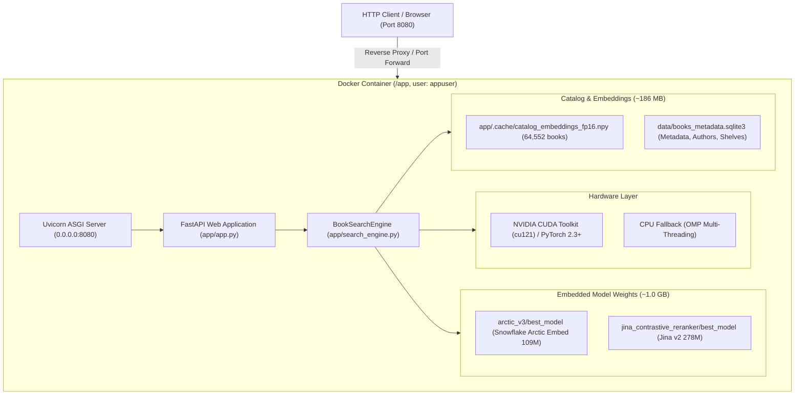

# Dockerizing ArcticDense: Neural Book Search Engine

Production-grade Docker deployment guide for **ArcticDense**, packaging the Two-Stage Cascade search engine (Snowflake Arctic Embed 109M Bi-Encoder + Jina Reranker v2 278M Cross-Encoder with Hybrid Cascade Fusion), FastAPI backend, pre-computed 64,552 book catalog embeddings, and SQLite metadata database into a self-contained, containerized environment.

---

## 1. Container Architecture



### Key Highlights
- **Universal Hardware Support**: Automatically utilizes NVIDIA GPUs with CUDA 12.1 runtime when available (`--gpus all`), or seamlessly falls back to optimized multi-threaded CPU execution.
- **Sub-15ms Startup**: Pre-baked 64,552 catalog embeddings cache (`catalog_embeddings_fp16.npy`) eliminates on-boot inference overhead.
- **Security Hardened**: Runs as non-root `appuser` (UID 1000) inside a Debian-based `python:3.11-slim-bookworm` container.
- **Built-In Health Checks**: Automatically polls `/api/health` every 30 seconds for zero-downtime orchestration.

---

## 2. Prerequisites

### Host System Requirements

| Environment | Minimum | Recommended |
| :--- | :--- | :--- |
| **GPU Mode** | NVIDIA GPU (4GB+ VRAM), Driver $\ge$ 525.60 | NVIDIA GPU (6GB+ VRAM, e.g., RTX 4050/3060/T4/A10G) |
| **CPU Mode** | 4 Cores, 4GB RAM | 8 Cores, 8GB RAM |
| **Docker Engine** | Docker 24.0+ & Docker Compose v2 | Docker Desktop / Docker Engine 26.0+ |
| **NVIDIA Container Toolkit** | Required for GPU mode | `nvidia-container-toolkit` installed on Linux host or Docker Desktop WSL2 GPU enabled |

---

## 3. Quickstart: Build & Run

### Step 1: Build Container Image
Build the production image locally:

```bash
docker build -t arctic-search:latest .
```

> **Note**: `.dockerignore` automatically filters out training datasets, checkpoints, virtual environments, and scratchpads, keeping the build context minimal.

---

### Step 2: Run the Container

#### Option A: GPU Accelerated (Recommended)
Run with all available NVIDIA GPUs:

```bash
docker run --gpus all \
  -d \
  -p 8080:8080 \
  --name arctic_book_search \
  --restart unless-stopped \
  arctic-search:latest
```

#### Option B: CPU Mode (Universal Fallback)
Run on any CPU laptop, server, or cloud VM:

```bash
docker run \
  -d \
  -p 8080:8080 \
  -e DEVICE=cpu \
  -e OMP_NUM_THREADS=4 \
  --name arctic_book_search_cpu \
  --restart unless-stopped \
  arctic-search:latest
```

---

## 4. Multi-Service Docker Compose Workflows (Search + Redis + Elasticsearch)

The Compose stack deploys a complete enterprise search architecture:
1. **`arctic-search`**: Two-Stage Cascade neural retriever (Snowflake Arctic Embed + Jina Reranker v2) on port 8080.
2. **`redis`**: Sub-millisecond query result and query embedding cache on port 6379.
3. **`elasticsearch`**: Distributed BM25 lexical keyword retrieval and catalog search cluster on port 9200.

### Starting the Stack

```bash
# Option A: GPU Accelerated Stack (RTX / CUDA)
docker compose up -d

# Option B: CPU Stack
docker compose -f docker-compose.cpu.yml up -d

# Check all 3 service health statuses
docker compose ps

# Follow unified logs
docker compose logs -f
```

### Indexing the 64,552 Books into Elasticsearch (Run Once)
```bash
# Execute indexing script inside the search container
docker compose exec arctic-search python tools/index_elasticsearch.py
```

---

## 5. Environment Variables Reference

| Variable | Default | Description |
| :--- | :--- | :--- |
| `PORT` | `8080` | HTTP listening port for Uvicorn |
| `HOST` | `0.0.0.0` | Network binding interface |
| `DEVICE` | `cuda` | Target compute device (`cuda` or `cpu`). Automatically falls back to `cpu` if CUDA is unavailable. |
| `OMP_NUM_THREADS` | `8` | Number of CPU threads allocated to PyTorch math operations |
| `WORKERS` | `1` | Uvicorn worker count (keep `1` per container to prevent redundant model memory duplication) |

---

## 6. Verification & Health Monitoring

### Health Endpoint
```bash
curl -f http://localhost:8080/api/health
```
**Response:**
```json
{
  "status": "ready",
  "ready": true,
  "catalog_indexed": 64552
}
```

### System Stats Endpoint
```bash
curl -f http://localhost:8080/api/stats
```
**Response:**
```json
{
  "status": "ready",
  "model_name": "Snowflake Arctic Embed (v1.5) - Fine-Tuned Champion",
  "catalog_size": 64552,
  "device": "cuda",
  "fp16_enabled": true,
  "supported_mrl_dimensions": [64, 128, 256, 512, 768]
}
```

### Automated Verification Script
Run the built-in end-to-end verification script:

```bash
python tools/verify_container.py --url http://localhost:8080
```

---

## 7. Cloud Production Deployment

### 1. Google Cloud Run (Serverless GPU / CPU)
Deploy as a scalable, serverless container:

```bash
# 1. Tag and push to Google Artifact Registry
gcloud artifacts repositories create arctic-repo --repository-format=docker --location=us-central1
docker tag arctic-search:latest us-central1-docker.pkg.dev/YOUR_PROJECT_ID/arctic-repo/arctic-search:latest
docker push us-central1-docker.pkg.dev/YOUR_PROJECT_ID/arctic-repo/arctic-search:latest

# 2. Deploy with GPU acceleration (NVIDIA L4)
gcloud beta run deploy arctic-search \
  --image=us-central1-docker.pkg.dev/YOUR_PROJECT_ID/arctic-repo/arctic-search:latest \
  --region=us-central1 \
  --gpu=1 \
  --gpu-type=nvidia-l4 \
  --memory=8Gi \
  --cpu=4 \
  --port=8080 \
  --allow-unauthenticated
```

---

### 2. AWS Elastic Container Service (ECS on EC2 GPU)
1. Push image to Amazon ECR:
   ```bash
   aws ecr create-repository --repository-name arctic-search
   docker tag arctic-search:latest <aws_account_id>.dkr.ecr.<region>.amazonaws.com/arctic-search:latest
   docker push <aws_account_id>.dkr.ecr.<region>.amazonaws.com/arctic-search:latest
   ```
2. Launch an ECS GPU Task on a `g4dn.xlarge` (NVIDIA T4 16GB) or `g5.xlarge` (NVIDIA A10G 24GB) instance with container resource requirement `gpu: 1`.

---

### 3. RunPod / Vast.ai (On-Demand GPU Pods)
Deploy directly onto serverless GPU pods:
- Container Image: `your-dockerhub-user/arctic-search:latest`
- Container Disk: 15 GB
- Exposed HTTP Port: `8080`
- GPU: 1x RTX 3060, RTX 4070, or A4000.

---

## 8. Development Volume Mounting (Hot Reloading)

To iterate on models or data without rebuilding the image, mount host paths:

```bash
docker run --gpus all \
  -p 8080:8080 \
  -v $(pwd)/arctic_output:/app/arctic_output:ro \
  -v $(pwd)/data/books_metadata.sqlite3:/app/data/books_metadata.sqlite3:ro \
  -v $(pwd)/app/.cache:/app/app/.cache \
  --name arctic_dev \
  arctic-search:latest
```
