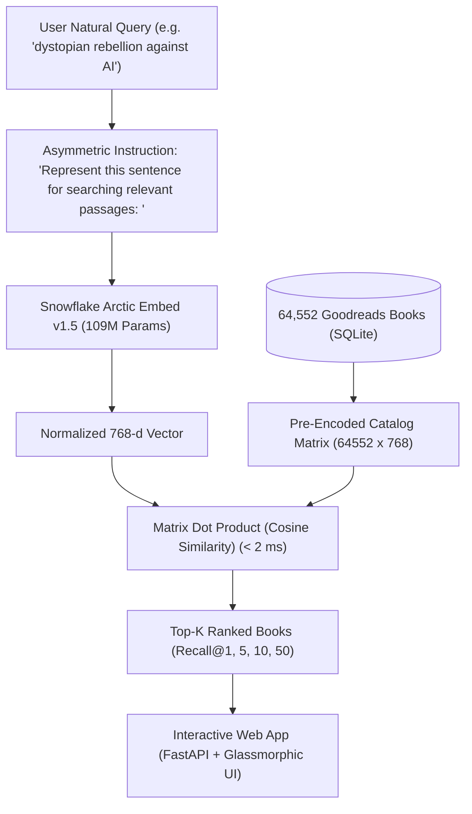
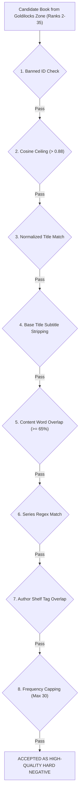

# ❄️ ArcticDense: Neural Book Search & Retrieval

[](https://www.python.org/downloads/)
[](https://pytorch.org/)
[](https://huggingface.co/Snowflake/snowflake-arctic-embed-m-v1.5)
[](https://fastapi.tiangolo.com)
[](https://opensource.org/licenses/MIT)

> An end-to-end dense neural book retrieval system fine-tuned across **64,552 Goodreads books**, powered by **`Snowflake/snowflake-arctic-embed-m-v1.5`** (109M parameters, 512 context window, 768 dimensions with Matryoshka MRL support). Includes an interactive web search application, multi-stage contrastive training pipeline, and an **8-layer false-negative defense shield** for targeted adversarial negative mining.

---

## 📌 Table of Contents
- [Architecture & System Overview](#-architecture--system-overview)
- [Empirical Performance Progression](#-empirical-performance-progression)
- [Directory Architecture](#-directory-architecture)
- [Finished Product: Interactive Web Application](#-finished-product-interactive-web-application)
- [The 8-Layer False-Negative Protection Shield](#-the-8-layer-false-negative-protection-shield)
- [Fine-Tuning Execution Pipeline](#-fine-tuning-execution-pipeline)
  - [Stage 1: Pretrained Baseline Evaluation](#stage-1-pretrained-baseline-evaluation)
  - [Stage 2: In-Batch Contrastive Training](#stage-2-in-batch-contrastive-training)
  - [Stage 3: Targeted Hard-Negative Training](#stage-3-targeted-hard-negative-training)
  - [Stage 4: Progressive Refinement (Champion Model)](#stage-4-progressive-refinement-champion-model)
- [Hardware & Optimization Telemetry](#-hardware--optimization-telemetry)
- [Author](#-author)

---

## 🚀 Architecture & System Overview

Traditional keyword search fails when readers search using abstract tropes, emotional vibes, or plot descriptions (*"dark academia boarding school mystery with secret society"*). 

ArcticDense projects user queries and rich book descriptions into a shared 768-dimensional semantic hypersphere, optimizing ranking using Multiple Negatives Ranking Loss (MNRL) and Matryoshka Representation Learning:



---

## 🏆 Empirical Performance Progression

Evaluated across all **32,170 unseen test queries** and **32,340 validation queries** searching the entire **64,552 Goodreads catalog** (100% work-clustered, zero edition contamination):

```mermaid
graph LR
    subgraph Baseline ["Stage 1: Pretrained Baseline"]
        B1["R@1: 21.67%"]
        B10["R@10: 55.40%"]
        B50["R@50: 69.57%"]
    end
    subgraph InBatch ["Stage 2: In-Batch Training"]
        P1["R@1: 29.16% (+7.49%)"]
        P10["R@10: 64.67% (+9.27%)"]
        P50["R@50: 78.20% (+8.63%)"]
    end
    subgraph HardNegs ["Stage 3: Targeted Hard Negs"]
        C1["R@1: 35.60% (+13.93%)"]
        C10["R@10: 73.96% (+18.56%)"]
        C50["R@50: 84.66% (+15.09%)"]
    end
    subgraph Champion ["Stage 4: Progressive Refinement"]
        C2_1["R@1: 35.48% (+13.81%)"]
        C2_10["R@10: 74.70% (+19.30%)"]
        C2_50["R@50: 85.51% (+15.94%)"]
    end
    Baseline --> InBatch --> HardNegs --> Champion
```



| Evaluation Split | Training Stage | Recall@1 | Recall@5 | Recall@10 | Recall@50 | Net Gain vs Baseline | Relative Gain |
| :--- | :--- | :---: | :---: | :---: | :---: | :---: | :---: |
| **Test Set**<br>*(32,170 queries)* | **Stage 1: Pretrained Baseline** | 21.67% | 48.41% | 55.40% | 69.57% | *Starting Point* | — |
| | **Stage 2: In-Batch Training** | 29.16% | 58.29% | 64.67% | 78.20% | :rocket: **+7.49% R@1, +9.27% R@10** | +16.7% |
| | **Stage 3: Targeted Hard Negatives** | 35.60% | 68.09% | 73.96% | 84.66% | 🌟 **+13.93% R@1, +18.56% R@10** | +33.5% |
| | **Stage 4: Progressive Refinement (Champion)** | **35.48%** | **68.50%** | **74.70%** | **85.51%** | 👑 **+13.81% R@1, +19.30% R@10** | **+34.8%** |
| **Validation Set**<br>*(32,340 queries)* | **Stage 1: Pretrained Baseline** | 22.24% | 49.02% | 55.43% | 69.41% | *Starting Point* | — |
| | **Stage 2: In-Batch Training** | 29.86% | 59.55% | 65.70% | 78.36% | :rocket: **+7.62% R@1, +10.27% R@10** | +18.5% |
| | **Stage 3: Targeted Hard Negatives** | 36.01% | 68.78% | 74.41% | 84.84% | 🌟 **+13.77% R@1, +18.98% R@10** | +34.2% |
| | **Stage 4: Progressive Refinement (Champion)** | **36.39%** | **69.51%** | **75.04%** | **85.65%** | 👑 **+14.15% R@1, +19.61% R@10** | **+35.4%** |

---

## 📂 Directory Architecture

The repository is modularly decoupled into the **finished application product**, the **end-to-end training pipeline**, the **core retrieval library**, and **empirical benchmark telemetry**:

```text
neural_book_search_arctic/
├── app/                                 # FINISHED PRODUCT / WEB APPLICATION
│   ├── app.py                           # FastAPI web application & REST search API
│   ├── search_engine.py                 # Core vector engine with MRL & SQLite enrichment
│   ├── templates/index.html             # Semantic HTML5 interface
│   ├── static/style.css                 # Glassmorphic modern dark-mode stylesheet
│   ├── static/script.js                 # Real-time search & modal interaction logic
│   └── README.md                        # Application quickstart guide
│
├── training/                            # END-TO-END FINE-TUNING PIPELINE
│   ├── 01_baseline_benchmark.py         # Stage 1: Zero-shot baseline evaluation
│   ├── 02_inbatch_training.py           # Stage 2: In-batch contrastive training (258k pairs)
│   ├── 03_mine_adversarial_negs.py      # Stage 3/4: Goldilocks mining & 8-layer defense shield
│   ├── 04_adversarial_training.py       # Stage 3/4: Targeted adversarial training & refinement
│   └── 05_evaluate_retriever.py         # 2D block-chunked catalog recall evaluator
│
├── src/                                 # REUSABLE CORE LIBRARY
│   ├── __init__.py
│   ├── config.py                        # Hardware configs, hyperparameters, paths
│   ├── data_loader.py                   # In-memory datasets, string normalizers
│   ├── filters.py                       # 8-layer false-negative defense shield
│   ├── metrics.py                       # GPU 2D block-chunked Recall@K engine
│   └── langchain_embed.py               # Custom LangChain embedding wrapper
│
├── data/                                # DATASETS & METADATA (Schema documented)
│   └── README.md                        # Database schema & split descriptions
│
├── results/                             # MASTER EMPIRICAL METRICS (JSON)
│   ├── baseline_metrics.json            # Stage 1 baseline metrics
│   ├── inbatch_contrastive_metrics.json # Stage 2 in-batch metrics
│   ├── adversarial_training_metrics.json# Stage 3 hard negative metrics
│   ├── progressive_refinement_metrics.json # Stage 4 champion model metrics
│   └── final_comparison.json            # Master comparative benchmark
│
├── docs/                                # DETAILED TECHNICAL DOCUMENTATION
├── mkdocs.yml                           # Material MkDocs documentation config
├── requirements.txt                     # Minimal production dependencies
└── README.md                            # Main project showcase
```

---

## 💻 Finished Product: Interactive Web Application

The `app/` folder contains a standalone, production-ready search interface:

```bash
# Launch the FastAPI web server
python app/app.py
```

Then visit **`http://127.0.0.1:8000`** in your browser.

* **Sub-15ms Latency**: Matrix inner products computed in milliseconds.
* **Matryoshka Dimension Switcher**: Seamlessly test 64-d, 128-d, 256-d, 512-d, or 768-d vector truncation.
* **Genre Filter & Detailed Modals**: Filter by Goodreads shelf tags or view full blurbs and citations.

---

## 🛡️ The 8-Layer False-Negative Protection Shield

A critical hazard in mining hard negatives is **False-Negative Poisoning**: penalizing unindexed editions, sequels, or adaptations that match the query. Before any candidate is accepted as a training negative, it must pass an 8-stage gatekeeper:



---

## 🛠️ Fine-Tuning Execution Pipeline

### Stage 1: Pretrained Baseline Evaluation
Establishes the untouched starting benchmark for `Snowflake/snowflake-arctic-embed-m-v1.5`:
```bash
python training/01_baseline_benchmark.py
```

### Stage 2: In-Batch Contrastive Training
Fine-tunes the model on 258,250 synthetic pairs with duplicate-positive masking:
```bash
python training/02_inbatch_training.py
```

### Stage 3: Targeted Hard-Negative Training
Mines confusion zone candidates (Ranks 2–35) with the 8-layer shield and trains with sub-batch negative chunking:
```bash
# 1. Mine Top-5 hard negatives
python training/03_mine_adversarial_negs.py --stage-name "Targeted Hard-Negative Mining"

# 2. Train retriever
python training/04_adversarial_training.py --stage "targeted_hard_negatives" --stage-name "Targeted Hard-Negative Training"
```

### Stage 4: Progressive Refinement (Champion Model)
Progressively mines 3 fresh negatives + 2 retained negatives to refine the decision boundary:
```bash
# 1. Progressive adversarial mining
python training/03_mine_adversarial_negs.py --stage-name "Progressive Adversarial Mining" --output-file "data/train_arctic_v3.jsonl"

# 2. Train champion model
python training/04_adversarial_training.py --stage "progressive_refinement" --stage-name "Progressive Refinement" --train-file "data/train_arctic_v3.jsonl"
```

---

## ⚡ Hardware & Optimization Telemetry

All stages were trained and benchmarked on a single consumer laptop GPU (**NVIDIA GeForce RTX 4050 6GB VRAM**):

* **VRAM Cliff Resolution**: Sub-batch negative chunking (`chunk_size=12`) eliminated PCIe thrashing, collapsing step latency by **55x (from 26.3s to 0.49s)**.
* **Mixed Precision (FP16)**: Halved tensor activation memory.
* **Non-Reentrant Checkpointing**: Eliminated activation memory leakage during backpropagation.
* **2D Block-Chunked Evaluation**: Avoided an 8.3 GB similarity matrix allocation, evaluating 32,170 queries in ~4 MB of peak memory.

---

## 👤 Author
**Nizam** (`nansari.0134@gmail.com`)  
GitHub: [https://github.com/nansari-0134/](https://github.com/nansari-0134/)
