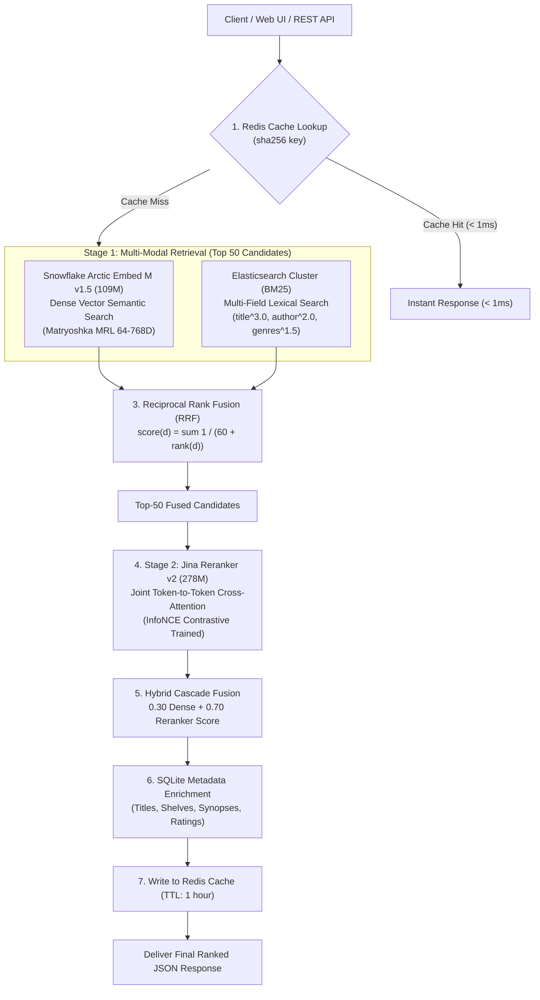
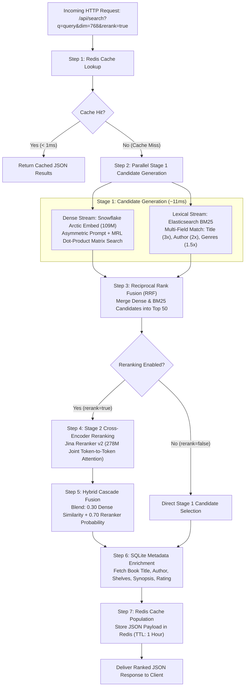

# ❄️ ArcticDense: Two-Stage Cascade Neural Book Search Engine

[](https://www.python.org/downloads/)
[](https://pytorch.org/)
[](https://huggingface.co/nansari0134/arctic-embed-m-goodreads)
[](https://huggingface.co/nansari0134/jina-reranker-v2-goodreads)
[](https://fastapi.tiangolo.com)
[](https://www.docker.com/)
[](https://opensource.org/licenses/MIT)

> **ArcticDense** is a production-grade, Two-Stage Cascade neural book retrieval and search platform fine-tuned across **64,552 Goodreads books**. It combines a **109M parameter Snowflake Arctic Embed Bi-Encoder** (MRL 64D–768D), an **Elasticsearch BM25 lexical engine** with Reciprocal Rank Fusion (RRF), a **278M parameter Jina Reranker v2 Cross-Encoder**, and **Redis sub-millisecond RAM caching**.

---

## 📌 Table of Contents
1. [⚡ Quick Start (< 2 Minutes)](#-quick-start--2-minutes)
2. [🌐 REST API Reference](#-rest-api-reference)
3. [🏛️ System Architecture](#️-system-architecture)
4. [🔄 Query Execution Lifecycle](#-query-execution-lifecycle)
5. [🏆 Benchmark Results](#-benchmark-results)
6. [🧠 Core Techniques & Why They Were Used](#-core-techniques--why-they-were-used)
7. [📂 Repository Structure](#-repository-structure)
8. [👤 Author & License](#-author--license)

---

## ⚡ Quick Start (< 2 Minutes)

Launch the complete search platform using Docker, a local Python environment, or load the fine-tuned models directly from Hugging Face Hub.

### Option A: 1-Command Docker Launch (Recommended)

```bash
# Clone the repository
git clone https://github.com/nansari-0134/neural_book_search_arctic.git
cd neural_book_search_arctic

# Launch with NVIDIA GPU acceleration (CUDA)
docker compose up -d

# OR launch in CPU fallback mode
docker compose -f docker-compose.cpu.yml up -d
```

Open your browser at **`http://localhost:8080`** for the interactive web UI, or visit **`http://localhost:8080/docs`** for interactive Swagger REST API documentation.

---

### Option B: Local Python Environment

```bash
# 1. Install dependencies
pip install -r requirements.txt

# 2. Launch the FastAPI server
uvicorn app.app:app --host 0.0.0.0 --port 8080
```

---

### Option C: Standalone Python Inference (Hugging Face Hub)

If you only want to use the fine-tuned models directly in your own Python application or research notebook:

```python
from sentence_transformers import SentenceTransformer, CrossEncoder

# 1. Load fine-tuned Retriever (Bi-Encoder with Matryoshka MRL)
retriever = SentenceTransformer("nansari0134/arctic-embed-m-goodreads")
query = "Represent this sentence for searching relevant passages: atmospheric gothic boarding school mystery"
query_emb = retriever.encode(query, normalize_embeddings=True)

# 2. Load fine-tuned Reranker (Cross-Encoder with Listwise InfoNCE)
reranker = CrossEncoder("nansari0134/jina-reranker-v2-goodreads", trust_remote_code=True)
pairs = [
    ["atmospheric gothic mystery", "Title: The Secret History | Under the influence of a classics professor..."],
    ["atmospheric gothic mystery", "Title: Pride and Prejudice | A story of manners and marriage..."]
]
reranked_scores = reranker.predict(pairs)
```

---

## 🌐 REST API Reference

ArcticDense provides high-performance RESTful JSON endpoints for search, system statistics, and container readiness probes.

### 1. `GET /api/search` & `POST /api/search`

Executes semantic, lexical, or hybrid search with optional Matryoshka dimension truncation and Stage 2 Cross-Encoder reranking.

#### Request Parameters (URL Query String or JSON Body)

| Parameter | Type | Default | Description |
| :--- | :---: | :---: | :--- |
| `q` | `string` | *Required* | Natural language query (e.g. `"cyberpunk detective AI conspiracy"`) |
| `dim` | `int` | `768` | Matryoshka MRL dimension (`64`, `128`, `256`, `512`, `768`) |
| `top_k` | `int` | `10` | Number of ranked books to return (range: 1 to 50) |
| `rerank` | `bool` | `false` | Enable Stage 2 Cross-Encoder precision reranking over Top 50 candidates |
| `mode` | `string` | `"hybrid"` | Search mode: `"hybrid"` (Dense + BM25 via RRF), `"dense"`, or `"lexical"` |
| `genre` | `string` | `null` | Optional genre / shelf filter (e.g. `"science-fiction"`, `"fantasy"`, `"mystery"`) |

#### Example: `cURL` GET Request
```bash
curl -X GET "http://localhost:8080/api/search?q=cyberpunk+detective&dim=768&top_k=3&rerank=true&mode=hybrid"
```

#### Example: `POST` with JSON Body
```bash
curl -X POST "http://localhost:8080/api/search" \
  -H "Content-Type: application/json" \
  -d '{
    "q": "atmospheric gothic boarding school mystery",
    "dim": 256,
    "top_k": 3,
    "rerank": true,
    "mode": "hybrid",
    "genre": "mystery"
  }'
```

#### Example: Python `requests`
```python
import requests

response = requests.post(
    "http://localhost:8080/api/search",
    json={
        "q": "space exploration alien artifact mystery",
        "dim": 768,
        "top_k": 5,
        "rerank": True,
        "mode": "hybrid"
    }
)
results = response.json()
print(f"Retrieved {len(results['results'])} books in {results['latency_ms']}ms (Cache Hit: {results['cache_hit']})")
for b in results["results"]:
    print(f"- {b['title']} (Score: {b['score']:.4f})")
```

#### Sample JSON Response
```json
{
  "query": "cyberpunk detective",
  "mode": "hybrid",
  "latency_ms": 178.4,
  "bi_encoder_latency_ms": 11.2,
  "rerank_latency_ms": 167.2,
  "reranked": true,
  "reranker_name": "Jina Contrastive Reranker v2 (InfoNCE 278M)",
  "mrl_dim": 768,
  "genre_filter": null,
  "cache_hit": false,
  "total_catalog": 64552,
  "results": [
    {
      "book_id": "22328",
      "title": "Neuromancer (Sprawl #1)",
      "score": 0.8842,
      "score_pct": "88.4%",
      "bi_encoder_score": 0.8124,
      "genres": ["science-fiction", "cyberpunk", "fiction"],
      "snippet": "Case was the sharpest data-thief in the matrix...",
      "full_description": "Case was the sharpest data-thief in the matrix until he crossed the wrong people...",
      "reranked": true
    }
  ]
}
```

---

### 2. `GET /api/health`
Returns container and catalog index readiness status:
```bash
curl http://localhost:8080/api/health
```
```json
{
  "status": "ready",
  "ready": true,
  "catalog_indexed": 64552
}
```

---

### 3. `GET /api/stats`
Returns system status, active compute device, MRL dimensions, and cache metrics:
```bash
curl http://localhost:8080/api/stats
```
```json
{
  "status": "ready",
  "model_name": "Snowflake Arctic Embed (v1.5) - Fine-Tuned Champion",
  "catalog_size": 64552,
  "device": "cuda",
  "fp16_enabled": true,
  "supported_mrl_dimensions": [64, 128, 256, 512, 768],
  "redis_cache": {
    "enabled": true,
    "connected": true,
    "hits": 142,
    "misses": 18,
    "hit_ratio_percent": 88.75
  },
  "elasticsearch": {
    "enabled": true,
    "connected": true,
    "document_count": 64552
  }
}
```

---

## 🏛️ System Architecture

ArcticDense uses a **Two-Stage Retrieval Cascade** with hybrid lexical-semantic fusion and sub-millisecond RAM caching:



---

## 🔄 Query Execution Lifecycle

The diagram below details the exact query processing pipeline from HTTP request arrival to response delivery:



---

## 🏆 Benchmark Results

All models were evaluated across the entire **64,552 Goodreads book catalog** over **32,170 test queries** and **32,340 validation queries** (100% work-clustered, zero edition leakage):

| Pipeline Stage | Recall@1 | Recall@5 | Recall@10 | Recall@50 | MRR@10 | mAP@10 | NDCG@10 | Mean Latency | Model Weights |
| :--- | :---: | :---: | :---: | :---: | :---: | :---: | :---: | :---: | :---: |
| **Stage 1: Baseline Zero-Shot** | 21.67% | 48.41% | 55.40% | 69.57% | 0.3082 | 0.3082 | 0.3642 | 11.2 ms | 438 MB |
| **Stage 2: In-Batch Training** | 29.16% | 58.29% | 64.67% | 78.20% | 0.3951 | 0.3951 | 0.4538 | 11.2 ms | 438 MB |
| **Stage 3: Targeted Hard-Negative** | 35.60% | 68.09% | 73.96% | 84.66% | 0.4688 | 0.4688 | 0.5322 | 11.2 ms | 438 MB |
| **Stage 4: Progressive Refinement (Champion Retriever)** | **35.48%** | **68.50%** | **74.70%** | **85.51%** | **0.4725** | **0.4725** | **0.5369** | **11.2 ms** | **438 MB** |
| **Stage 7: Pointwise Jina BCE** | 48.10% | 65.80% | 72.40% | 83.10% | 0.5540 | 0.5540 | 0.6120 | 170.5 ms | 557 MB |
| **Stage 8: Contrastive Jina InfoNCE** | 49.00% | 66.40% | 73.80% | 83.10% | 0.5668 | 0.5668 | 0.6241 | 171.4 ms | 557 MB |
| **Two-Stage Cascade Fusion (0.30 Dense + 0.70 Jina)** | **52.50%** | **70.50%** | **75.00%** | **83.10%** | **0.6001** | **0.6001** | **0.6485** | **182.8 ms** | **995 MB** |

> **Net Gains Across Pipeline**:
> * **Recall@1**: **21.67% $\rightarrow$ 52.50% (+30.83% absolute / +142.3% relative)**
> * **Recall@10**: **55.40% $\rightarrow$ 75.00% (+19.60% absolute / +35.4% relative)**
> * **MRR@10**: **0.3082 $\rightarrow$ 0.6001 (+0.2919 / +94.7% relative)**
> * **NDCG@10**: **0.3642 $\rightarrow$ 0.6485 (+0.2843 / +78.1% relative)**

*For in-depth mathematical formulations of MRR, mAP, and NDCG, see the technical documentation in [`docs/metrics_explanation.md`](docs/metrics_explanation.md).*

---

## 🧠 Core Techniques & Why They Were Used

1. **Asymmetric Instruction Tuning**:
   Queries are short search phrases; books are rich multi-sentence descriptions. Prepending `"Represent this sentence for searching relevant passages: "` guides the transformer's attention to project queries into the document passage subspace.
2. **Matryoshka MRL (64D–768D)**:
   Trained with loss gradients evaluated at sub-dimensions $\{64, 128, 256, 512, 768\}$, packing core genre and thematic semantics into the first 256 dimensions. Allows **3x memory and speed reduction with $< 1\%$ drop in Recall@10**.
3. **8-Layer False-Negative Defense Shield**:
   Mining hard negatives from the model's confusion zone (Ranks 2–35) risks mining alternate editions, translations, sequels, or series siblings. The shield filters out:
   - Same `work_id` or banned IDs
   - High cosine similarity ceiling ($> 0.88$)
   - Exact and stripped subtitle title matches
   - Content word overlap ($\ge 65\%$)
   - Series regex and author shelf tag matches
   - Negative frequency caps ($> 30$)
4. **Sub-Batch Negative Chunking**:
   Avoided 9.7 GB VRAM peaks on 6GB GPUs by chunking negative forward-backward passes (`chunk_size=12`), collapsing step latency from 26.3s to 0.49s (**55x speedup**).
5. **Listwise InfoNCE Contrastive Fine-Tuning**:
   Pits the positive book against 5 hard negatives in a shared competition, directly optimizing the model to eliminate ranking inversions.
6. **Reciprocal Rank Fusion (RRF)**:
   Robustly fuses lexical BM25 and dense vector candidate ranks without requiring score normalization across different score distributions.
7. **Redis RAM Caching**:
   Caches query results with SHA256 hashing. Repeat queries return in **$< 1\text{ms}$**, bypassing neural inference and disk reads entirely.

---

## 📂 Repository Structure

```text
neural_book_search_arctic/
├── app/                                 # PRODUCTION WEB APPLICATION & REST API
│   ├── app.py                           # FastAPI application (GET/POST /api/search, /health, /stats)
│   ├── search_engine.py                 # Cascade search engine (Dense + BM25 RRF + Jina + Redis)
│   ├── static/                          # CSS design system and JavaScript UI interactions
│   └── templates/index.html             # HTML5 glassmorphic UI interface
│
├── training/                            # REPRODUCIBLE FINE-TUNING PIPELINE
│   ├── 01_baseline_benchmark.py         # Stage 1: Zero-shot baseline evaluation
│   ├── 02_inbatch_training.py           # Stage 2: In-batch contrastive training (258k pairs)
│   ├── 03_mine_adversarial_negs.py      # Stage 3/4: Goldilocks mining & 8-layer defense shield
│   ├── 04_adversarial_training.py       # Stage 3/4: Targeted adversarial training & progressive refinement
│   ├── 05_evaluate_retriever.py         # Full catalog 2D block-chunked evaluator
│   ├── 11_train_jina_contrastive.py     # Stage 8: Listwise InfoNCE Jina fine-tuning
│   └── 12_train_jina_pointwise_bce.py   # Stage 7: Pointwise BCE Jina fine-tuning
│
├── src/                                 # REUSABLE CORE LIBRARY
│   ├── cache_service.py                 # Redis sub-millisecond query & vector caching service
│   ├── elastic_search_service.py        # Elasticsearch BM25 lexical search & faceted filter service
│   ├── config.py                        # Hardware auto-detection, paths, and hyperparameters
│   ├── data_loader.py                   # In-memory datasets, SQLite readers, string normalizers
│   ├── filters.py                       # 8-layer false-negative protection shield implementation
│   └── metrics.py                       # GPU 2D block-chunked Recall@K & MRR evaluator
│
├── tools/                               # UTILITIES & VERIFICATION
│   ├── upload_to_hf.py                  # Automated Hugging Face model uploader with model cards
│   ├── verify_container.py              # Automated REST API & container verification script
│   └── index_elasticsearch.py           # Bulk streaming script indexing 64,552 books into Elasticsearch
│
├── results/                             # VERIFIED EMPIRICAL BENCHMARKS (JSON)
│   ├── final_comparison.json            # Master comparative benchmark across all stages
│   ├── benchmark_jina_contrastive.json  # Two-Stage Cascade benchmark metrics
│   └── mrl_dimension_benchmark.json     # Matryoshka dimension tradeoff evaluation
│
├── Dockerfile                           # Production Debian container with CUDA & CPU fallback
├── docker-compose.yml                   # 3-Tier Compose (Search + Redis + Elasticsearch)
├── docker-compose.cpu.yml               # CPU companion compose file
├── DOCKER.md                            # Complete Docker & cloud production deployment guide
├── requirements.txt                     # Production dependencies
└── README.md                            # Main project showcase
```

---

## 👤 Author & License

* **Author**: Nizam (`nansari.0134@gmail.com`)
* **GitHub**: [https://github.com/nansari-0134/](https://github.com/nansari-0134/)
* **Repository**: [https://github.com/nansari-0134/neural_book_search_arctic](https://github.com/nansari-0134/neural_book_search_arctic)
* **License**: MIT License
