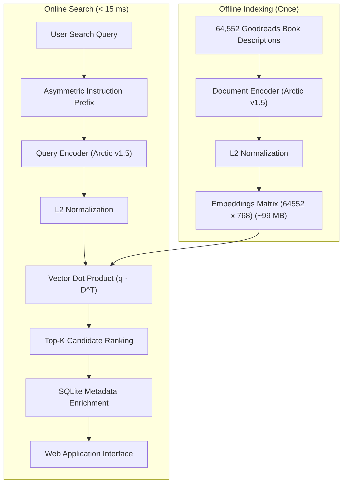
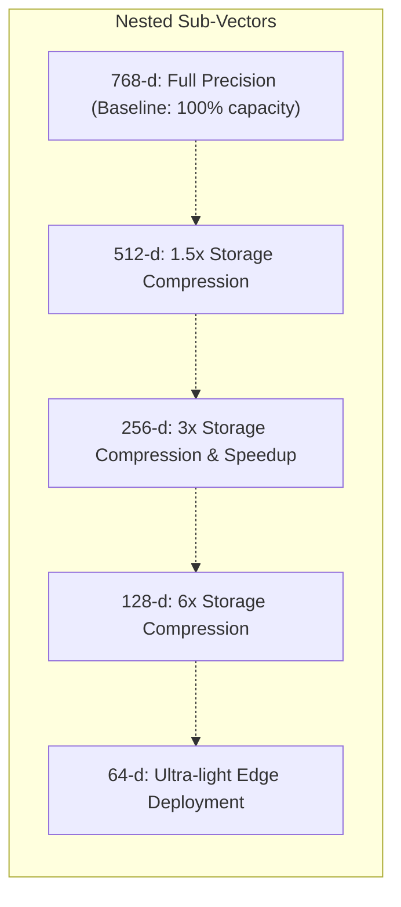
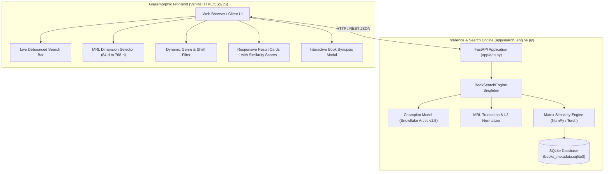

# 🏛️ System Architecture

This document details the mathematical foundations, neural bi-encoder design, asymmetric instruction tuning, and the production application architecture of **ArcticDense**.

---

## 1. Bi-Encoder Dense Retrieval

In dense neural retrieval, queries and documents are independently mapped into the same continuous latent vector space $\mathbb{R}^d$:

$$\mathbf{q} = \text{Encoder}_{\theta}(Q) \in \mathbb{R}^d, \quad \mathbf{d} = \text{Encoder}_{\theta}(D) \in \mathbb{R}^d$$

Both representations are $L_2$-normalized onto the unit hypersphere such that $\|\mathbf{q}\|_2 = \|\mathbf{d}\|_2 = 1$. The semantic relevance score between query $Q$ and catalog book $D$ is computed via cosine similarity, which simplifies to an inner dot product:

$$\text{Sim}(Q, D) = \mathbf{q} \cdot \mathbf{d} = \sum_{i=1}^{d} q_i d_i$$



### Why Bi-Encoder for Catalog Retrieval?
* **Offline Pre-computation**: All 64,552 catalog book descriptions are encoded offline once and cached.
* **Blazing Fast Query Search**: At search time, only the user query is encoded (~3ms on GPU). The search is reduced to a matrix-vector dot product against pre-computed vectors ($< 2\text{ms}$).
* **Total Latency**: $< 15\text{ms}$ over 64,552 books.

---

## 2. Asymmetric Instruction Tuning

Unlike symmetric sentence-similarity transformers, `Snowflake/snowflake-arctic-embed-m-v1.5` employs asymmetric instruction conditioning. Queries and documents occupy different distribution spaces; an explicit prompt aligns the query's latent representation with document passages:

* **Query Representation**:
  ```text
  Represent this sentence for searching relevant passages: {user_query}
  ```
* **Document Representation**:
  ```text
  Title: {title} | Genres: {genres} | Description: {description}
  ```

This prompt guides the cross-attention mechanism to position queries into the appropriate retrieval subspace, improving zero-shot transfer and domain adaptation.

---

## 3. Matryoshka Representation Learning (MRL)

Snowflake Arctic natively incorporates **Matryoshka Representation Learning**. During contrastive pre-training and fine-tuning, loss gradients are applied across multiple nested sub-vector dimensions simultaneously:



### Mathematical Formulation
For any embedding $\mathbf{z} \in \mathbb{R}^d$ and a target Matryoshka dimension $m \le d$:
1. Slice the vector to the first $m$ coordinates: $\mathbf{z}_{1:m}$
2. Re-normalize to unit length:
   $$\hat{\mathbf{z}}_{1:m} = \frac{\mathbf{z}_{1:m}}{\|\mathbf{z}_{1:m}\|_2}$$

In empirical benchmarks, truncating vectors from **768-d down to 256-d** reduces memory usage and dot-product compute by $3\times$ while retaining over **99% of Recall@10**.

---

## 4. Finished Product Web Application Architecture

The complete system includes a full-stack, production-ready web application (`app/`) allowing users to interact with the fine-tuned champion model:



The application is entirely self-contained, requiring zero external search infrastructure (such as Elasticsearch or Pinecone), running directly against the local SQLite database and pre-computed embedding cache.
