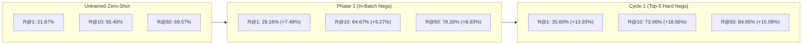

# 📈 Benchmark Progression & Empirical Results

This document tracks empirical performance across training cycles on the **64,552 book catalog** evaluated over **32,170 test queries** and **32,340 validation queries** (100% work-clustered, zero edition contamination).

---

## 📊 Comprehensive Results Summary

---

## 🏆 Full-Catalog Evaluation Comparison

All evaluations search across the **entire 64,552-book catalog** in exact rank order using GPU 2D block-chunking:

| Evaluation Split | Model Stage | Recall@1 | Recall@5 | Recall@10 | Recall@50 | Delta vs Baseline |
| :--- | :--- | :---: | :---: | :---: | :---: | :---: |
| **Test Set** *(32,170 queries)* | **BGE-Small Baseline** *(Prior Ref)* | 11.52% | 32.80% | 38.84% | 53.22% | — |
| | **BGE-Small Fine-Tuned** *(Prior Ref)* | 21.27% | 53.85% | 60.45% | 74.68% | — |
| | **Snowflake Arctic Baseline** | **21.67%** | **48.41%** | **55.40%** | **69.57%** | Starting Point |
| | **Snowflake Arctic Phase 1** | **29.16%** | **58.29%** | **64.67%** | **78.20%** | :rocket: **+7.49% R@1, +9.27% R@10** |
| | **Snowflake Arctic Cycle 1** | **35.60%** | **68.09%** | **73.96%** | **84.66%** | 🌟 **+13.93% R@1, +18.56% R@10** |
| | **Snowflake Arctic Cycle 2** | *Pending* | *Pending* | *Pending* | *Pending* | Target: >76% R@10 |
| **Validation Set** *(32,340 queries)* | **Snowflake Arctic Baseline** | **22.24%** | **49.02%** | **55.43%** | **69.41%** | Starting Point |
| | **Snowflake Arctic Phase 1** | **29.86%** | **59.55%** | **65.70%** | **78.36%** | :rocket: **+7.62% R@1, +10.27% R@10** |
| | **Snowflake Arctic Cycle 1** | **36.01%** | **68.78%** | **74.41%** | **84.84%** | 🌟 **+13.77% R@1, +18.98% R@10** |

---

## ⚡ Phase 1 Training Telemetry

The Phase 1 contrastive fine-tuning was executed on a single consumer laptop GPU (**NVIDIA GeForce RTX 4050 6GB VRAM**):

| Hyperparameter / Metric | Observed Value | Description |
| :--- | :--- | :--- |
| **Dataset Size** | **258,250 pairs** | 51,650 training books $\times$ 5 synthetic trope queries |
| **Total Steps** | **16,141 steps** | 1 full epoch with batch size 16 and grad accum 2 (eff. batch 32) |
| **Execution Time** | **761.2 minutes (~12.7 hours)** | Average step latency: ~2.4 seconds |
| **Loss Trajectory** | **`1.7508` $\rightarrow$ `0.6073`** | Stable monotonic decline without spikes |
| **Peak Learning Rate** | **`1.50e-05`** | Linear warmup (807 steps) + Cosine decay to `0.0` |
| **VRAM Footprint** | **5,879 MiB / 6,141 MiB** | 95.7% VRAM utilization with FP16 + Gradient Checkpointing |
| **Thermal Profile** | **74°C sustained** | Stable power draw: 73W / 80W max |

### Loss Milestones During Training

| Training Progress | Optimizer Step | Recorded MNRL Loss | Learning Rate | Elapsed Time |
| :---: | :---: | :---: | :---: | :---: |
| **0.3%** | Step 50 / 16,141 | **1.7508** | $4.65 \times 10^{-7}$ | 1.9 min |
| **12.4%** | Step 2,000 / 16,141 | **1.2842** | $1.48 \times 10^{-5}$ | 94.2 min |
| **24.8%** | Step 4,000 / 16,141 | **1.0519** | $1.39 \times 10^{-5}$ | 188.5 min |
| **49.6%** | Step 8,000 / 16,141 | **0.8234** | $9.82 \times 10^{-6}$ | 377.0 min |
| **74.3%** | Step 12,000 / 16,141 | **0.6841** | $4.31 \times 10^{-6}$ | 565.8 min |
| **100.0%** | Step 16,141 / 16,141 | **0.6073** | $0.00$ | 761.2 min (12.7h) |

---

## ⚡ Cycle 1 Training Telemetry (Adversarial Hard Negatives)

Cycle 1 fine-tuning introduced **5 actively mined hard negatives per query** (199,808 adversarial pairs) and was trained with sub-batch negative chunking and non-reentrant gradient checkpointing:

| Hyperparameter / Metric | Observed Value | Description |
| :--- | :--- | :--- |
| **Dataset Size** | **199,808 pairs** | 5 adversarial hard negatives mined from 64,552 books |
| **Micro-Batch / Grad Accum** | **Batch 4 / Accum 8** | Effective batch size: 32 (exact gradient preservation) |
| **Total Micro-Steps** | **49,952 micro-steps** | 6,244 full optimizer steps |
| **Negative Chunking** | **Chunk Size: 12** | Prevents WDDM PCIe paging thrash |
| **Execution Time** | **416.7 minutes (~6.9 hours)** | Average step latency: **0.49 seconds** (vs 26.3s unoptimized) |
| **VRAM Footprint** | **2,835 – 3,429 MiB** | Stable 55% utilization on RTX 4050 6GB |
| **Thermal & Power** | **74–77°C sustained** | Stable power draw: 73W – 76W (100% compute bound) |
| **Final Loss** | **`1.4070` $\rightarrow$ `0.5841`** | Strong convergence on adversarial pairs |

## 🎯 Evaluation Protocol & Recall Math

For any query $q$, let $\text{Rank}(q, d^+)$ be the 1-indexed position of the ground-truth book $d^+$ when sorting all $N = 64,552$ catalog books by descending cosine similarity:

$$\text{Recall@K} = \frac{1}{|Q|} \sum_{q \in Q} \mathbb{I}\left(\text{Rank}(q, d^+) \le K\right)$$

* **Recall@1**: Measures exact first-try precision. A jump from **21.67% to 29.16%** means almost 1 in every 3 user trope queries now returns the exact target book as the very first search result.
* **Recall@10**: Represents typical "Page 1" retrieval performance. Reaching **64.67%** ensures nearly two-thirds of all semantic queries place the ground truth book within the top 10 search cards.
* **Recall@50**: Represents candidate generation recall for the downstream cross-encoder reranker. At **78.20%**, the reranker receives a high-quality candidate pool.
