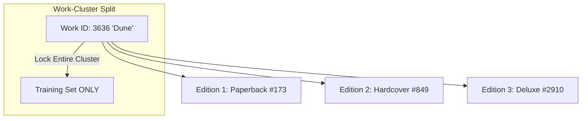

# 📊 Data Pipeline & Work-Clustering

This section describes data extraction, formatting, and the work-cluster splitting mechanism that prevents benchmark leakage.

---

## 1. Raw Catalog Ingestion

Data originates from the UCSD Goodreads Books dataset (2.08 GB compressed). For each book, we extract and cache into SQLite:
* `book_id`: Unique Goodreads edition identifier
* `title`: Canonical book title
* `authors`: Extracted author names
* `description`: Publisher synopsis (up to 900 characters)
* `popular_shelves`: Top 15 community shelf tags (e.g., *sci-fi*, *dystopian*, *ya*)

### Structural Representation
Each book is formatted with explicit semantic prefixes to establish clear token boundaries:
```text
Title: The Name of the Wind | Genres: fantasy, fiction, magic, adventure | Description: Told in Kvothe's own voice...
```

---

## 2. Synthetic Query Generation

We leveraged open-source Large Language Models (Qwen3-8B) to synthesize 5 realistic search queries per book, ranging from broad genres to hyper-specific plot tropes:
1. **Query 1 (Broad Genre)**: *"epic high fantasy novel with university magic system"*
2. **Query 2 (Plot Trope)**: *"story about an orphaned musician seeking revenge against mythical demons"*
3. **Query 3 (Character Dynamic)**: *"cunning protagonist telling his life story to a biographer"*

---

## 3. Work-Cluster Splitting (Zero Data Leakage)

A common flaw in retrieval benchmarks is random train/test splitting. In book catalogs, a single literary work (e.g., *Dune*) exists under dozens of ISBNs and editions (paperback, hardcover, audiobooks, translations).

If Paperback Edition $A$ is placed in **Train** and Hardcover Edition $B$ is placed in **Test**, the neural network simply memorizes the book rather than learning generalizable semantics.



We clustered books by Goodreads `work_id` (the parent intellectual property):
* **80% Train Clusters**
* **10% Validation Clusters**
* **10% Test Clusters**

Zero editions of training books ever appear in Validation or Test.
