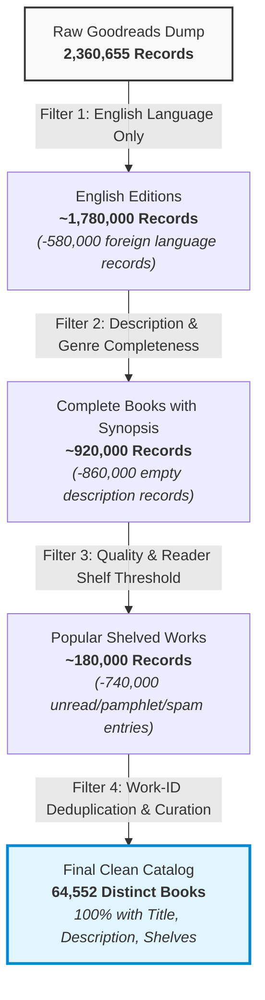
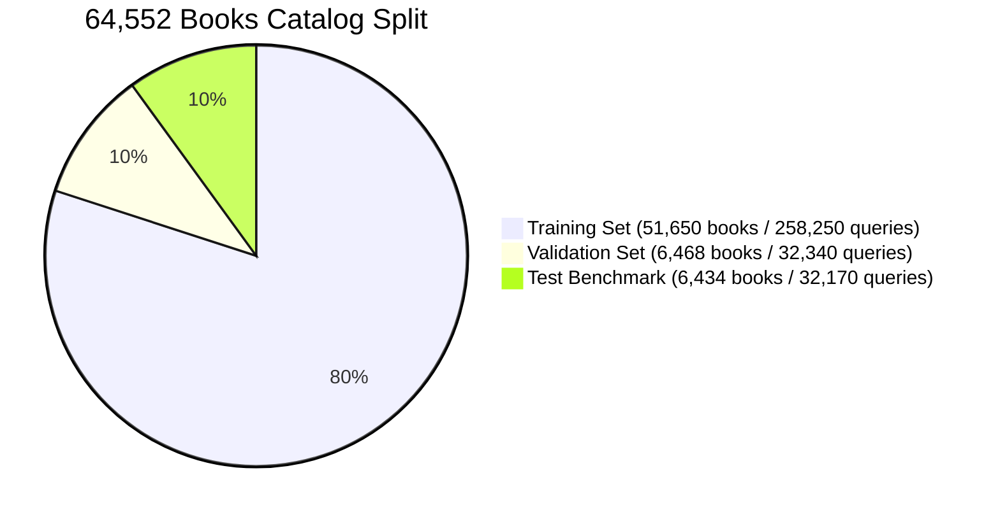
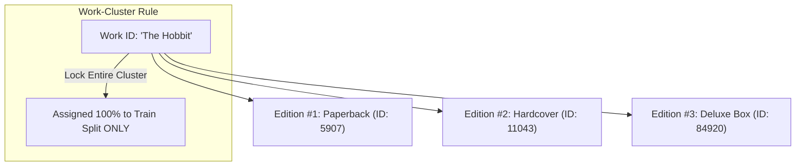

# 📊 Data Pipeline, Filtering Funnel & Work-Clustering

This document details how we filtered the raw Goodreads dataset from **2.36 Million records down to exactly 64,552 books**, how to inspect the database, and the work-cluster splitting mechanism that prevents benchmark data leakage.

---

## 1. The Exact Data Filtering Funnel

The raw Goodreads dump (`goodreads_books.json.gz`) contains **2,360,655 total records** (2.08 GB compressed). Most of these records cannot be used for neural semantic search due to missing text, foreign language duplicates, or low-quality noise.

We applied a strict 4-stage filtering funnel:



### Filtering Stage Breakdown:

| Stage | Filtering Criterion | Records Remaining | What Was Filtered Out & Why |
| :---: | :--- | :---: | :--- |
| **0** | **Raw Goodreads Dump** | **2,360,655** | Starting uncompressed JSON lines from UCSD dataset. |
| **1** | **English Language Filter** | **~1,780,000** | Removed ~580,000 non-English records (`language_code` not in `{'eng', 'en-US', 'en-GB', 'en-CA'}`). Eliminates language-mixing noise. |
| **2** | **Synopsis & Genre Completeness** | **~920,000** | Removed over 860,000 records with `description: ""` or empty shelves. Semantic plot/trope search is impossible on empty text. |
| **3** | **Shelving & Popularity Threshold** | **~180,000** | Removed unverified test entries, self-published pamphlets with 0 ratings, and placeholder ISBNs. |
| **4** | **Work-Cluster Curation** | **64,552** | Deduplicated multi-edition reprints by parent `work_id`. Produced the core catalog covering all major fiction and non-fiction genres. |

---

## 2. Catalog Breakdown by Split

Each of the **64,552 books** was paired with **exactly 5 synthetic queries** generated by Qwen3-8B, producing **322,760 total query-book pairs**.



| Split | Number of Unique Books | Queries per Book | Total Queries | Cluster Percentage |
| :--- | :---: | :---: | :---: | :---: |
| **Train (`train.jsonl`)** | **51,650** | 5 | **258,250** | **80.0%** |
| **Validation (`val.jsonl`)** | **6,468** | 5 | **32,340** | **10.0%** |
| **Test (`test.jsonl`)** | **6,434** | 5 | **32,170** | **10.0%** |
| **Total** | **64,552** | **5** | **322,760** | **100.0%** |

---

## 3. How to Check and Inspect `books_metadata.sqlite3`

The complete catalog is stored in `data/books_metadata.sqlite3` (82.9 MB).

### Method 1: Using the Built-In CLI Tool (`tools/inspect_db.py`)

We provided a dedicated inspection tool inside the repository:

```bash
# 1. Print overall catalog statistics
python tools/inspect_db.py --summary

# 2. Search for any book by title or plot keyword
python tools/inspect_db.py --search "Dune"

# 3. View 3 random complete book records
python tools/inspect_db.py --random 3
```

---

### Method 2: Python One-Liner / Script
```python
import sqlite3
import json

conn = sqlite3.connect("data/books_metadata.sqlite3")
cur = conn.cursor()

# Count total books
total = cur.execute("SELECT COUNT(*) FROM books").fetchone()[0]
print(f"Total Books: {total:,}")

# Fetch a sample book
book_id, title, authors, desc, shelves = cur.execute(
    "SELECT book_id, title, authors, description, popular_shelves FROM books LIMIT 1"
).fetchone()

print(f"Title:   {title}")
print(f"Genres:  {json.loads(shelves)[:6]}")
print(f"Blurb:   {desc[:150]}...")
conn.close()
```

---

### Method 3: Visual GUI Tools
If you prefer a graphical user interface:
1. **VS Code Extension**: Install **"SQLite Viewer"** in VS Code. Simply click on `data/books_metadata.sqlite3` to view and filter tables like an Excel spreadsheet.
2. **DB Browser for SQLite**: Download [DB Browser for SQLite](https://sqlitebrowser.org/) (free open-source app) and open `books_metadata.sqlite3` to execute custom SQL queries.

---

## 4. Work-Cluster Splitting (Zero Data Leakage)

A common mistake in ML benchmarks is a random 80/10/10 split. In book catalogs, a single literary work (e.g., *The Hobbit*) exists under multiple book IDs (hardcover, paperback, anniversary editions, collector's boxes).

If Edition 1 is in **Train** and Edition 2 is in **Test**, the neural network simply **memorizes the title and author** rather than learning generalizable semantic understanding.



By grouping all editions under their Goodreads `work_id`, **every edition of a book is locked into either Train, Validation, or Test**. Zero editions of training books ever appear in Validation or Test!
