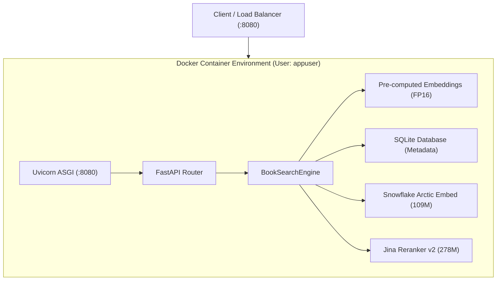

# Docker & Cloud Production Deployment

This guide covers containerizing and deploying the **ArcticDense** Two-Stage Cascade search engine (Snowflake Arctic Embed 109M Bi-Encoder + Jina Reranker v2 278M Cross-Encoder) for local testing and cloud production environments.

---

## 1. Container Overview

The Docker container encapsulates:
1. **FastAPI Web Service**: High-performance asynchronous API server served by Uvicorn.
2. **Two-Stage Cascade Engine**:
   - **Stage 1 (Retriever)**: Snowflake Arctic Embed M v1.5 with Matryoshka Representation Learning (MRL 64D–768D).
   - **Stage 2 (Reranker)**: Jina Reranker v2 (278M parameters) with InfoNCE contrastive fine-tuning and Hybrid Cascade Fusion ($0.30 \text{ Dense} + 0.70 \text{ Jina}$).
3. **Data Assets**:
   - `books_metadata.sqlite3` (86.9 MB SQLite metadata with full book details and shelves).
   - `catalog_embeddings_fp16.npy` (99.2 MB pre-computed half-precision embeddings for 64,552 books).
4. **Universal Hardware Driver**:
   - NVIDIA CUDA 12.1 acceleration via PyTorch wheels.
   - Automatic CPU fallback with multi-threaded OpenMP execution.

---

## 2. Container Architecture



---

## 3. Quickstart Commands

### Building the Image
```bash
docker build -t arctic-search:latest .
```

### Running with NVIDIA GPU
```bash
docker run --gpus all \
  -d \
  -p 8080:8080 \
  --name arctic_book_search \
  --restart unless-stopped \
  arctic-search:latest
```

### Running in CPU Mode
```bash
docker run \
  -d \
  -p 8080:8080 \
  -e DEVICE=cpu \
  -e OMP_NUM_THREADS=4 \
  --name arctic_book_search_cpu \
  --restart unless-stopped \
  arctic-search:latest
```

---

## 4. Multi-Service Docker Compose Orchestration (Search + Elasticsearch + Redis)

The production Docker Compose stack spins up 3 networked services:
1. **`arctic-search`**: FastAPI + GPU-accelerated Snowflake Arctic & Jina Reranker v2 engine
2. **`redis`**: Sub-millisecond query result and embedding vector cache
3. **`elasticsearch`**: Distributed BM25 lexical keyword retrieval and faceted catalog index

### Running the Full Stack

```bash
# GPU-Accelerated Stack (Search Engine + Redis + Elasticsearch)
docker compose up -d

# CPU-Only Stack
docker compose -f docker-compose.cpu.yml up -d

# Check cluster health
docker compose ps

# Index 64,552 books into Elasticsearch (run once):
docker compose exec arctic-search python tools/index_elasticsearch.py
```

---

## 5. Automated Verification

Verify health and query execution against the running container:

```bash
python tools/verify_container.py --url http://localhost:8080
```

Sample verification output:
```text
============================================================
  ArcticDense Container Verification: http://localhost:8080
============================================================
[*] Testing Healthcheck Endpoint: http://localhost:8080/api/health
    [SUCCESS] Status 200 in 15.2ms
    Catalog Indexed: 64,552 books
[*] Testing System Stats Endpoint: http://localhost:8080/api/stats
    [SUCCESS] Status 200 in 1.4ms
    Model:      Snowflake Arctic Embed (v1.5) - Fine-Tuned Champion
    Device:     cuda
    FP16:       True
    Dimensions: [64, 128, 256, 512, 768]
[*] Testing Dense Retrieval Query ('cyberpunk detective artificial intelligence')
    [SUCCESS] Status 200 in 11.8ms
    Retrieved 3 books in 11.2ms
      1. Neuromancer (Sprawl #1) (Sim: 0.812)
      2. Neuromancer (Sprawl Trilogy, #1) (Sim: 0.804)
      3. Count Zero (Sprawl, #2) (Sim: 0.778)
[*] Testing Two-Stage Cascade Rerank Query
    [SUCCESS] Status 200 in 172.4ms
    Reranked via: Jina Contrastive Reranker v2 (InfoNCE 278M)
    Retrieved 3 books in 171.8ms
      1. Neuromancer (Sprawl #1) (Score: 0.884)
============================================================
```

---

## 6. Cloud Deployment Targets

### Google Cloud Run
Deploy with serverless GPU:
```bash
gcloud beta run deploy arctic-search \
  --image=us-central1-docker.pkg.dev/YOUR_PROJECT_ID/repo/arctic-search:latest \
  --region=us-central1 \
  --gpu=1 \
  --gpu-type=nvidia-l4 \
  --memory=8Gi \
  --cpu=4 \
  --port=8080 \
  --allow-unauthenticated
```

### AWS ECS / EC2 (GPU)
1. Push to ECR.
2. Deploy ECS Task with resource requirement `gpu: 1` on EC2 instance types `g4dn.xlarge` (NVIDIA T4 16GB) or `g5.xlarge` (NVIDIA A10G 24GB).
3. Bind port 8080 to an Application Load Balancer (ALB).
