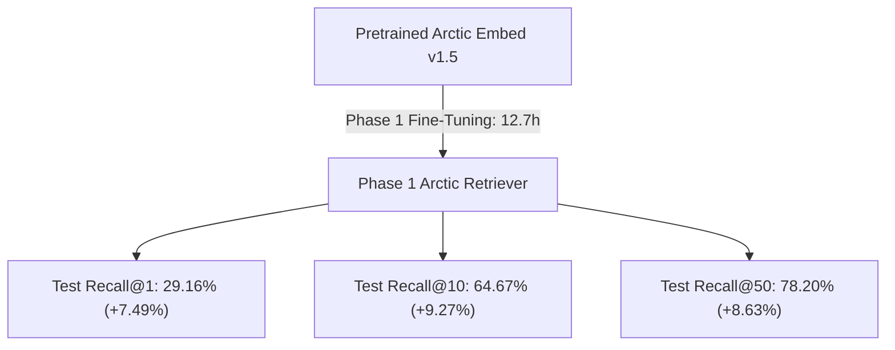

# ⚡ Contrastive Fine-Tuning

This section covers the loss function, duplicate-positive masking, and training loop optimizations.

---

## 1. Multiple Negatives Ranking Loss (MNRL / InfoNCE)

We optimize the model using **Multiple Negatives Ranking Loss** with temperature scaling $\tau = 0.05$.

Given a micro-batch of $B$ queries, each query $i$ has:
* Target positive book $\mathbf{d}_i^+$
* Mined hard negatives $\mathbf{d}_{i, m}^-$
* In-batch negatives from the remaining $(B - 1)$ queries

$$P(\mathbf{d}_i^+ \mid \mathbf{q}_i) = \frac{\exp\left(\frac{\mathbf{q}_i \cdot \mathbf{d}_i^+}{\tau}\right)}{\exp\left(\frac{\mathbf{q}_i \cdot \mathbf{d}_i^+}{\tau}\right) + \sum_{j \neq i} \exp\left(\frac{\mathbf{q}_i \cdot \mathbf{d}_j^+}{\tau}\right) + \sum_{m} \exp\left(\frac{\mathbf{q}_i \cdot \mathbf{d}_{i, m}^-}{\tau}\right)}$$

The loss is the cross-entropy across all queries in the batch:

$$\mathcal{L} = -\frac{1}{B} \sum_{i=1}^{B} \log P(\mathbf{d}_i^+ \mid \mathbf{q}_i)$$

---

## 2. Duplicate-Positive Loss Masking

In realistic data, multiple synthetic queries can reference the exact same popular book. If Query 1 and Query 4 in the same batch both target *The Hobbit*:
* Standard MNRL assumes Query 1's positive is book #1 and treats book #4 as an incorrect negative!
* This penalizes the model for predicting a true match.

### Implementation Fix
```python
pos_ids = batch["positive_id"]
if len(set(pos_ids)) < len(pos_ids):
    mask = torch.zeros_like(logits, dtype=torch.bool)
    for i, pid_i in enumerate(pos_ids):
        for j, pid_j in enumerate(pos_ids):
            if i != j and pid_i == pid_j:
                mask[i, j] = True
    logits = logits.masked_fill(mask, float("-inf"))
```

---

## 3. Hardware & Memory Optimizations (RTX 4050 6GB)

* **Mixed Precision (FP16)**: Halves activation memory and leverages Tensor Cores.
* **Gradient Checkpointing**: Discards forward intermediate activations and recomputes them during backprop, reducing VRAM by ~60%.
* **Gradient Accumulation**: Micro-batch size 16 accumulated over 2 steps delivers an effective batch size of 32 while using only ~3.2 GB of VRAM.
* **Atomic Double-Buffered Checkpointing**: Periodically rotates checkpoints (`resume_state.pt` and `.prev`) atomically to withstand system sleep or crashes without corruption.

---

## 4. Phase 1 Execution & Results

Phase 1 fine-tuning completed across all 258,250 training pairs on the NVIDIA RTX 4050 Laptop GPU:

* **Optimizer**: AdamW (`lr=1.5e-5`, weight decay `0.01`)
* **Schedule**: Linear warmup (807 steps) followed by Cosine Annealing decay
* **Total Optimizer Steps**: 8,071 steps (16,141 micro-batches)
* **Training Time**: 761.2 minutes (~12.7 hours)
* **Loss Convergence**: `1.7508` (Step 50) $\rightarrow$ `0.6073` (Step 16,141)

### Benchmark Summary



See [Benchmark Progression](benchmarks.md) for full catalog metrics and comparative analysis.

---

## 5. Cycle 1 Fine-Tuning & The "VRAM Cliff" Fix

Cycle 1 trained the retriever on **199,808 adversarial pairs** with **Top-5 actively mined hard negatives per query**.

### 🛠️ The 99-Hour Bottleneck & The Engineering Solution
In an initial unchunked pass, each micro-batch of 16 queries required encoding $16\text{ queries} + 16\text{ pos} + (16 \times 5 = 80\text{ hard negs}) = \mathbf{112\text{ sequences of 512 tokens}}$.
* This demanded **~9.7 GB VRAM**, exceeding the 6 GB RTX 4050 capacity.
* Windows WDDM silently paged activation tensors across the PCIe bus to shared system RAM, slowing step latency to **26.3s/step (99-hour ETA)**.

We solved this without dropping a single hard negative via a 3-point architectural fix:
1. **Sub-Batch Negative Chunking**: In `embed_train(texts, chunk_size=12)`, hard negatives are encoded in slices of 12, capping peak VRAM at **~3.4 GB**.
2. **Equivalent Micro-Batching**: Setting `batch_size = 4` with `grad_accum = 8` maintains an **effective batch size of 32** with exact mathematical gradient equivalence.
3. **Non-Reentrant Checkpointing**: `use_reentrant=False` eliminates legacy PyTorch activation leaks.

**Result**: Step latency collapsed from **26.3s $\rightarrow$ 0.49s (55x speedup)**, allowing Cycle 1 to complete in **6.9 hours** instead of 99 hours!

### 📈 Cycle 1 Empirical Results (64,552 Books)

| Metric | Baseline | Phase 1 | Cycle 1 (Mined Top-5 Negs) | Gain vs Baseline |
| :--- | :---: | :---: | :---: | :---: |
| **Recall@1** | 21.67% | 29.16% | **35.60%** | **+13.93% (+64% rel)** |
| **Recall@5** | 48.41% | 58.29% | **68.09%** | **+19.68% (+41% rel)** |
| **Recall@10** | 55.40% | 64.67% | **73.96%** | **+18.56% (+33% rel)** |
| **Recall@50** | 69.57% | 78.20% | **84.66%** | **+15.09% (+22% rel)** |

---

## 6. Cycle 2 Progressive Fine-Tuning & Results

Cycle 2 fine-tuned the retriever on **179,319 progressive adversarial pairs** from `data/train_arctic_v3.jsonl`:
* **Starting Weights**: `arctic_output/arctic_v2/best_model` (Cycle 1 checkpoint)
* **Warm-Start Loss**: Started at **`1.1224`** $\rightarrow$ converged to **`0.5312`**
* **Adversarial Negatives**: 3 fresh negatives mined from Cycle 1's confusion boundary + 2 retained Cycle 1 negatives (Top-5 hard negatives per query)
* **Schedule**: 5,604 optimizer steps with cosine annealing decay
* **Training Time**: **374.8 minutes (~6.2 hours)**
* **Output Checkpoint**: [arctic_output/arctic_v3/best_model](file:///c:/Users/Shilpa/OneDrive/Documents/Book%20Semantic%20Search/neural_book_search_arctic/arctic_output/arctic_v3/best_model)

### 📈 Full Progression Comparison (64,552 Books Catalog)

| Metric | Baseline | Phase 1 | Cycle 1 (Mined Top-5) | Cycle 2 (Champion Model) | Total Gain vs Baseline |
| :--- | :---: | :---: | :---: | :---: | :---: |
| **Recall@1** | 21.67% | 29.16% | 35.60% | **35.48%** | 🌟 **+13.81% (+64% rel)** |
| **Recall@5** | 48.41% | 58.29% | 68.09% | **68.50%** | 🌟 **+20.09% (+42% rel)** |
| **Recall@10** | 55.40% | 64.67% | 73.96% | **74.70%** | 👑 **+19.30% (+35% rel)** |
| **Recall@50** | 69.57% | 78.20% | 84.66% | **85.51%** | 🌟 **+15.94% (+23% rel)** |


