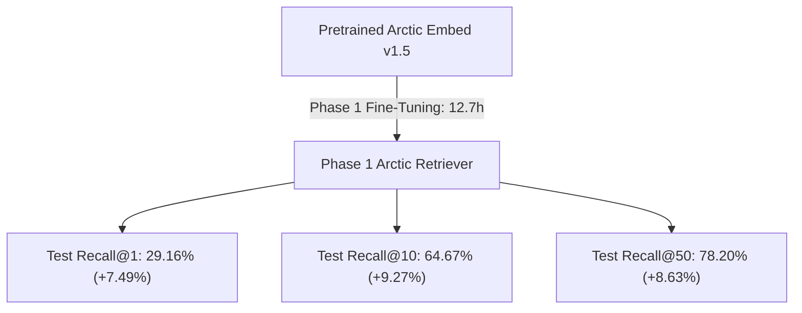

# ⚡ Contrastive Fine-Tuning

This section covers the loss function, duplicate-positive masking, and training loop optimizations.

---

## 1. Multiple Negatives Ranking Loss (MNRL / InfoNCE)

We optimize the model using **Multiple Negatives Ranking Loss** with temperature scaling $\tau = 0.05$.

Given a micro-batch of $B$ queries, each query $i$ has:
* Target positive book $\mathbf{d}_i^+$
* Mined hard negatives $\mathbf{d}_{i, m}^-$
* In-batch negatives from the remaining $(B - 1)$ queries

$$P(\mathbf{d}_i^+ \mid \mathbf{q}_i) = \frac{\exp\left(\frac{\mathbf{q}_i \cdot \mathbf{d}_i^+}{\tau}\right)}{\exp\left(\frac{\mathbf{q}_i \cdot \mathbf{d}_i^+}{\tau}\right) + \sum_{j \neq i} \exp\left(\frac{\mathbf{q}_i \cdot \mathbf{d}_j^+}{\tau}\right) + \sum_{m} \exp\left(\frac{\mathbf{q}_i \cdot \mathbf{d}_{i, m}^-}{\tau}\right)}$$

The loss is the cross-entropy across all queries in the batch:

$$\mathcal{L} = -\frac{1}{B} \sum_{i=1}^{B} \log P(\mathbf{d}_i^+ \mid \mathbf{q}_i)$$

---

## 2. Duplicate-Positive Loss Masking

In realistic data, multiple synthetic queries can reference the exact same popular book. If Query 1 and Query 4 in the same batch both target *The Hobbit*:
* Standard MNRL assumes Query 1's positive is book #1 and treats book #4 as an incorrect negative!
* This penalizes the model for predicting a true match.

### Implementation Fix
```python
pos_ids = batch["positive_id"]
if len(set(pos_ids)) < len(pos_ids):
    mask = torch.zeros_like(logits, dtype=torch.bool)
    for i, pid_i in enumerate(pos_ids):
        for j, pid_j in enumerate(pos_ids):
            if i != j and pid_i == pid_j:
                mask[i, j] = True
    logits = logits.masked_fill(mask, float("-inf"))
```

---

## 3. Hardware & Memory Optimizations (RTX 4050 6GB)

* **Mixed Precision (FP16)**: Halves activation memory and leverages Tensor Cores.
* **Gradient Checkpointing**: Discards forward intermediate activations and recomputes them during backprop, reducing VRAM by ~60%.
* **Gradient Accumulation**: Micro-batch size 16 accumulated over 2 steps delivers an effective batch size of 32 while using only ~3.2 GB of VRAM.
* **Atomic Double-Buffered Checkpointing**: Periodically rotates checkpoints (`resume_state.pt` and `.prev`) atomically to withstand system sleep or crashes without corruption.

---

## 4. Phase 1 Execution & Results

Phase 1 fine-tuning completed across all 258,250 training pairs on the NVIDIA RTX 4050 Laptop GPU:

* **Optimizer**: AdamW (`lr=1.5e-5`, weight decay `0.01`)
* **Schedule**: Linear warmup (807 steps) followed by Cosine Annealing decay
* **Total Optimizer Steps**: 8,071 steps (16,141 micro-batches)
* **Training Time**: 761.2 minutes (~12.7 hours)
* **Loss Convergence**: `1.7508` (Step 50) $\rightarrow$ `0.6073` (Step 16,141)

### Benchmark Summary



See [Benchmark Progression](benchmarks.md) for full catalog metrics and comparative analysis.

