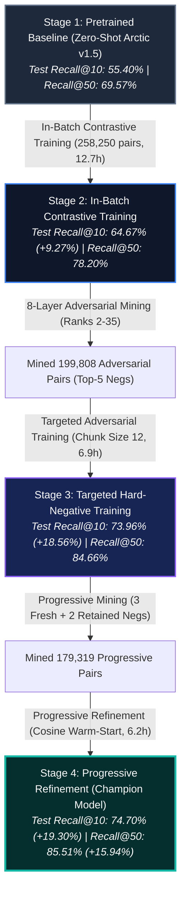
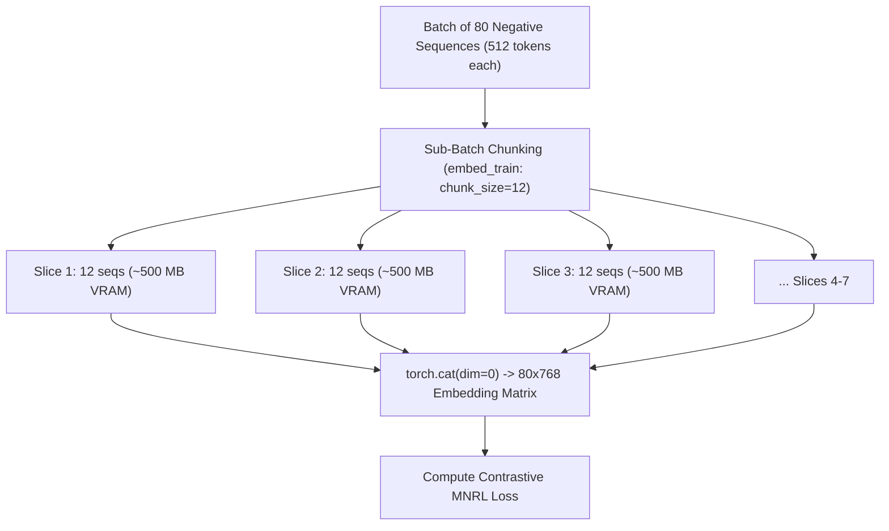

# ⚡ Contrastive Fine-Tuning & Training Progression

This document details the mathematical loss formulations, duplicate-positive loss masking, hardware memory optimizations, and the empirical progression across the **four fine-tuning stages** that produced our champion book retriever.

---

## 1. Multiple Negatives Ranking Loss (MNRL / InfoNCE)

We optimize the dense retriever using **Multiple Negatives Ranking Loss** with temperature scaling $\tau = 0.05$.

Given a micro-batch of $B$ queries, each query $i$ is associated with:
* Target positive book $\mathbf{d}_i^+$
* Mined hard negatives $\mathbf{d}_{i, m}^-$
* In-batch negatives formed by positive documents of the other $(B - 1)$ queries

The predicted probability that positive document $\mathbf{d}_i^+$ matches query $\mathbf{q}_i$ is given by the softmax over all candidates:

$$P(\mathbf{d}_i^+ \mid \mathbf{q}_i) = \frac{\exp\left(\frac{\mathbf{q}_i \cdot \mathbf{d}_i^+}{\tau}\right)}{\exp\left(\frac{\mathbf{q}_i \cdot \mathbf{d}_i^+}{\tau}\right) + \sum_{j \neq i} \exp\left(\frac{\mathbf{q}_i \cdot \mathbf{d}_j^+}{\tau}\right) + \sum_{m} \exp\left(\frac{\mathbf{q}_i \cdot \mathbf{d}_{i, m}^-}{\tau}\right)}$$

The objective minimizes the cross-entropy loss across all queries in the batch:

$$\mathcal{L} = -\frac{1}{B} \sum_{i=1}^{B} \log P(\mathbf{d}_i^+ \mid \mathbf{q}_i)$$

---

## 2. Duplicate-Positive Loss Masking

In large-scale synthetic datasets, multiple user queries often describe different facets of the exact same popular book. If Query 1 and Query 4 in the same batch both target *The Hobbit*:
* Standard MNRL assumes Query 1's ground truth is candidate #1 and treats candidate #4 as an incorrect negative.
* This erroneously penalizes the model for predicting a true match, producing toxic gradients.

### Implementation Solution
We dynamically detect duplicate positive IDs within each micro-batch and mask out cross-query duplicates with $-\infty$ before computing softmax:

```python
pos_ids = batch["positive_id"]
if len(set(pos_ids)) < len(pos_ids):
    mask = torch.zeros_like(logits, dtype=torch.bool)
    for i, pid_i in enumerate(pos_ids):
        for j, pid_j in enumerate(pos_ids):
            if i != j and pid_i == pid_j:
                mask[i, j] = True
    logits = logits.masked_fill(mask, float("-inf"))
```

---

## 3. The 4-Stage Fine-Tuning Progression



---

## 4. Stage 2: In-Batch Contrastive Training

* **Input Data**: 258,250 query-book positive pairs (`data/train.jsonl`) generated by Qwen3-8B across 51,650 training books.
* **Objective**: Establish domain adaptation on book metadata syntax (`Title: ... | Genres: ... | Description: ...`).
* **Negatives**: In-batch negatives formed from other books in the micro-batch, filtered via duplicate-positive masking.
* **Training Telemetry**:
  - Micro-batch size: 16 | Gradient accumulation: 2 (effective batch: 32)
  - Optimizer: AdamW (`lr=1.5e-5`, weight decay `0.01`, warmup ratio 0.1)
  - Training time: **761.2 minutes (~12.7 hours)** across 16,141 micro-batches
  - Loss trajectory: **`1.7508` $\rightarrow$ `0.6073`**
* **Output Checkpoint**: `arctic_output/arctic_phase1/best_model`

---

## 5. Stage 3: Targeted Hard-Negative Training & The "VRAM Cliff" Fix

### The 99-Hour Bottleneck
When scaling from in-batch negatives to **Top-5 actively mined hard negatives per query**, each micro-batch of 16 queries required encoding:
$$16\text{ queries} + 16\text{ positive books} + (16 \times 5 = 80\text{ hard negatives}) = \mathbf{112\text{ sequences of 512 tokens}}$$

* This required **~9.7 GB of peak activation memory**, drastically exceeding the 6 GB VRAM limit of consumer laptop GPUs (NVIDIA RTX 4050).
* Windows WDDM silently paged activation tensors over the PCIe bus to system RAM, causing severe thrashing that exploded step latency to **26.3 seconds/step (projected 99-hour runtime)**.

### The 3-Point Architectural Fix
We eliminated the VRAM cliff without dropping a single hard negative:



1. **Sub-Batch Negative Chunking**: In `embed_train(texts, chunk_size=12)`, hard negative sequences are tokenized and forward-propagated in slices of 12, capping peak VRAM at **~3.4 GB**.
2. **Equivalent Micro-Batching**: Setting `batch_size = 4` with `grad_accum = 8` preserves the **effective batch size of 32** with exact mathematical gradient equivalence.
3. **Non-Reentrant Gradient Checkpointing**: `use_reentrant=False` prevents activation tensor accumulation during backward passes.

**Empirical Speedup**: Step latency collapsed from **26.3s $\rightarrow$ 0.49s (55x speedup)**. Stage 3 completed in **6.9 hours** instead of 99 hours!

* **Output Checkpoint**: `arctic_output/arctic_v2/best_model`

---

## 6. Stage 4: Progressive Refinement (Champion Model)

As the retriever absorbed the initial hard negatives, its decision boundary shifted. Books that were previously confused became easy, while a new tier of subtle confusions emerged.

* **Progressive Mining Strategy**: Mined 3 fresh adversarial negatives from the new model's confusion zone and retained 2 robust negatives from Stage 3 (Top-5 negatives per query).
* **Warm-Start Optimization**: Initialized directly from Stage 3 checkpoint weights.
* **Loss Convergence**: Started at **`1.1224`** and converged smoothly to **`0.5312`** across 5,604 optimizer steps.
* **Training Time**: **374.8 minutes (~6.2 hours)**.
* **Output Checkpoint**: `arctic_output/arctic_v3/best_model` (438 MB).

---

## 7. Master Comparison Across All 4 Stages (64,552 Books)

Evaluated across all **32,170 unseen test queries** and **32,340 validation queries** searching the entire catalog:

| Split | Metric | Stage 1: Pretrained Baseline | Stage 2: In-Batch Training | Stage 3: Targeted Hard Negatives | Stage 4: Progressive Refinement (Champion) | Net Gain vs Baseline | Relative Gain |
| :--- | :--- | :---: | :---: | :---: | :---: | :---: | :---: |
| **Test Set** | **Recall@1** | 21.67% | 29.16% | 35.60% | **35.48%** | 🌟 **+13.81%** | **+63.7%** |
| *(32,170 queries)* | **Recall@5** | 48.41% | 58.29% | 68.09% | **68.50%** | 🌟 **+20.09%** | **+41.5%** |
| | **Recall@10** | 55.40% | 64.67% | 73.96% | **74.70%** | 👑 **+19.30%** | **+34.8%** |
| | **Recall@50** | 69.57% | 78.20% | 84.66% | **85.51%** | 🌟 **+15.94%** | **+22.9%** |
| **Validation Set** | **Recall@1** | 22.24% | 29.86% | 36.01% | **36.39%** | 🌟 **+14.15%** | **+63.6%** |
| *(32,340 queries)* | **Recall@5** | 49.02% | 59.55% | 68.78% | **69.51%** | 🌟 **+20.49%** | **+41.8%** |
| | **Recall@10** | 55.43% | 65.70% | 74.41% | **75.04%** | 👑 **+19.61%** | **+35.4%** |
| | **Recall@50** | 69.41% | 78.36% | 84.84% | **85.65%** | 🌟 **+16.24%** | **+23.4%** |
