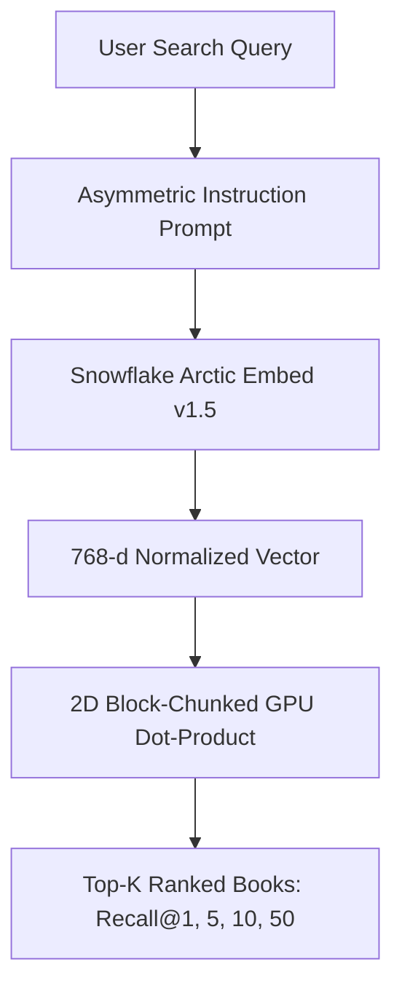

# ❄️ ArcticDense: Neural Book Retriever

Welcome to the technical documentation for **ArcticDense: Neural Book Retriever**, an end-to-end dense vector retrieval engine fine-tuned across **64,552 Goodreads books** using **Snowflake Arctic Embed (v1.5)**.

---

## 🎯 Executive Overview

Traditional keyword search fails when readers search with vague thematic descriptions (*"atmospheric gothic mystery in a rainy coastal town"*), character dynamics (*"enemies to lovers fantasy with royalty"*), or obscure plot tropes. 

This platform implements a state-of-the-art dense vector retriever using **`Snowflake/snowflake-arctic-embed-m-v1.5`** (109M parameters, 512 context window, 768 dimensions with native Matryoshka MRL support), systematically fine-tuned through multi-stage contrastive training and adversarial negative mining.

---

## 🏆 Empirical Retrieval Progression Across Stages (64,552 Books)

The retriever was developed through four rigorous stages of empirical optimization against the full **64,552 Goodreads book catalog** evaluated over **32,170 unseen test queries**:

```mermaid
graph LR
    subgraph S1 ["Stage 1: Pretrained Baseline"]
        B1["R@1: 21.67%"]
        B10["R@10: 55.40%"]
        B50["R@50: 69.57%"]
    end
    subgraph S2 ["Stage 2: In-Batch Training"]
        P1["R@1: 29.16% (+7.49%)"]
        P10["R@10: 64.67% (+9.27%)"]
        P50["R@50: 78.20% (+8.63%)"]
    end
    subgraph S3 ["Stage 3: Targeted Hard Negs"]
        C1["R@1: 35.60% (+13.93%)"]
        C10["R@10: 73.96% (+18.56%)"]
        C50["R@50: 84.66% (+15.09%)"]
    end
    subgraph S4 ["Stage 4: Progressive Refinement"]
        C2_1["R@1: 35.48% (+13.81%)"]
        C2_10["R@10: 74.70% (+19.30%)"]
        C2_50["R@50: 85.51% (+15.94%)"]
    end
    S1 --> S2 --> S3 --> S4
```

| Evaluation Metric | Stage 1: Pretrained Baseline | Stage 2: In-Batch Training | Stage 3: Targeted Hard Negatives | Stage 4: Progressive Refinement (Champion) | Total Gain vs Baseline | Relative Improvement |
| :--- | :---: | :---: | :---: | :---: | :---: | :---: |
| **Recall@1** | 21.67% | 29.16% (+7.49%) | 35.60% (+13.93%) | **35.48%** | 🌟 **+13.81%** | **+63.7%** |
| **Recall@5** | 48.41% | 58.29% (+9.88%) | 68.09% (+19.68%) | **68.50%** | 🌟 **+20.09%** | **+41.5%** |
| **Recall@10** | 55.40% | 64.67% (+9.27%) | 73.96% (+18.56%) | **74.70%** | 👑 **+19.30%** | **+34.8%** |
| **Recall@50** | 69.57% | 78.20% (+8.63%) | 84.66% (+15.09%) | **85.51%** | 🌟 **+15.94%** | **+22.9%** |

*All evaluations search across the entire 64,552-book catalog with zero edition leakage (100% work-clustered). See [Benchmark Progression](benchmarks.md) for full breakdown.*

---

## 🔑 Key Engineering & Architectural Highlights

* **State-of-the-Art Transformer**: Built on `snowflake-arctic-embed-m-v1.5`, holding top positions on MTEB Retrieval benchmarks for its size class.
* **Full Context Handling**: 512 tokens sequence length, capturing entire book synopses, genre tags, and series notes without lossy truncation.
* **Contrastive Multiple Negatives Ranking Loss (MNRL)**: Leverages in-batch negatives with duplicate-positive masking to prevent false penalization.
* **8-Layer False-Negative Protection Shield**: Blocks toxic gradients during adversarial hard negative mining (blocks identical works, series siblings, author tags, and cosine ceiling $>0.88$).
* **VRAM Cliff Engineering Fix**: Sub-batch negative chunking (`chunk_size=12`) and non-reentrant gradient checkpointing collapsed step latency by **55x (from 26.3s to 0.49s)** on 6GB VRAM GPUs.
* **Matryoshka Representation Learning (MRL)**: Flexible vector dimensions (768 down to 256 or 128) with $< 1\%$ drop in Recall@10 for $3\times$ faster vector search.
* **Finished Product Application**: Integrated FastAPI web server and modern dark-mode interface in `app/` delivering real-time search in `< 15ms`.

---

## 🚀 Quick Navigation

* [System Architecture](architecture.md): Deep dive into dense retrieval, asymmetric instructions, and MRL mechanics.
* [Data Pipeline & Clustering](data_pipeline.md): Goodreads metadata curation, Qwen3 synthetic queries, and `work_id` cluster splitting.
* [Contrastive Fine-Tuning](fine_tuning.md): MNRL loss math, duplicate masking, sub-batch chunking, and the 4 training stages.
* [Iterative Negative Mining](iterative_mining.md): Mining from the model's confusion zone (Ranks 2–35) and the 8-layer defense shield.
* [Benchmark Progression](benchmarks.md): Comprehensive results progression table, loss trajectories, and hardware telemetry.
* [Recall@K Metrics Math](metrics_explanation.md): 2D block-chunking algorithm and exact evaluation math.
