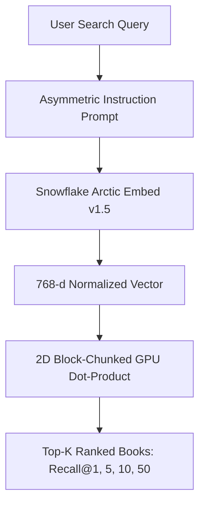

# ❄️ Neural Book Search with Snowflake Arctic Embed (v1.5)

Welcome to the technical documentation for **Neural Book Search**, an end-to-end dense retrieval and trope-based search engine fine-tuned across **64,552 Goodreads books**.

---

## 🎯 Executive Overview

Traditional keyword search fails when readers search with vague thematic descriptions (*"atmospheric gothic mystery in a rainy coastal town"*), character dynamics (*"enemies to lovers fantasy with royalty"*), or obscure plot tropes. 

This platform implements a state-of-the-art dense vector retriever using **`Snowflake/snowflake-arctic-embed-m-v1.5`** (109M parameters, 512 context window, 768 dimensions with native Matryoshka MRL support).

---

## 🔑 Key Features
* **State-of-the-Art Transformer**: Built on `snowflake-arctic-embed-m-v1.5`, holding the #1 spot on MTEB Retrieval benchmarks for its size class.
* **Full Context Handling**: 512 tokens sequence length, capturing entire book synopses, genre tags, and series notes without lossy truncation.
* **Contrastive Multiple Negatives Ranking Loss (MNRL)**: Leverages in-batch negatives with duplicate-positive masking.
* **8-Layer False-Negative Protection Engine**: Eliminates toxic gradients during hard negative mining (blocks identical works, series siblings, author tags, and cosine ceiling $>0.88$).
* **Matryoshka Representation Learning (MRL)**: Flexible vector dimensions (768 down to 256 or 128) for $3\times$ faster vector search.
* **Hardware Optimized**: Fully operational on consumer laptop GPUs (NVIDIA RTX 4050 6GB VRAM) via FP16 mixed precision, gradient checkpointing, and gradient accumulation.

---

## 🚀 Quick Navigation
* [System Architecture](architecture.md): Deep dive into dense retrieval & bi-encoder mechanics.
* [Data Pipeline & Clustering](data_pipeline.md): Goodreads metadata extraction, Qwen3 synthetic queries, and `work_id` cluster splitting.
* [Contrastive Fine-Tuning](fine_tuning.md): MNRL loss, duplicate-aware masking, and learning schedules.
* [Iterative Negative Mining](iterative_mining.md): Multi-cycle mining and the 8-layer defense shield.
* [Benchmark Progression](benchmarks.md): Comprehensive results progression table.
* [Hugging Face Deployment](huggingface.md): Publishing models to Hugging Face Hub.
