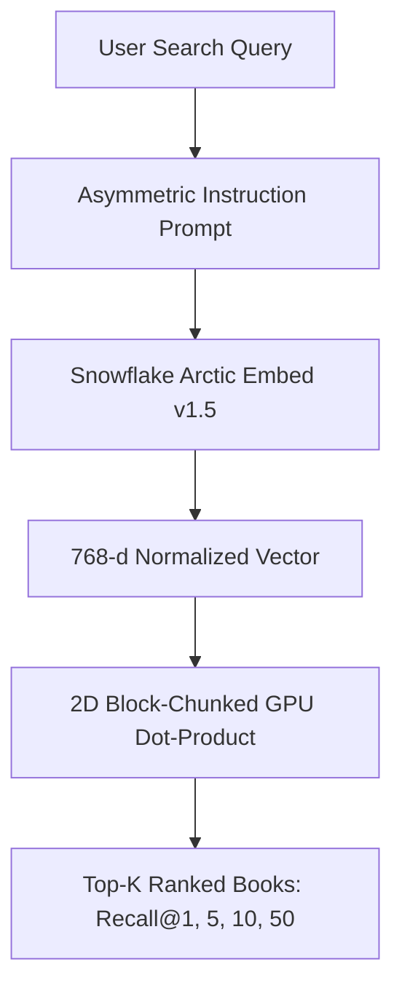

# ❄️ ArcticDense: Neural Book Retriever

Welcome to the technical documentation for **ArcticDense: Neural Book Retriever**, an end-to-end dense vector retrieval engine fine-tuned across **64,552 Goodreads books** using **Snowflake Arctic Embed (v1.5)**.

---

## 🎯 Executive Overview

Traditional keyword search fails when readers search with vague thematic descriptions (*"atmospheric gothic mystery in a rainy coastal town"*), character dynamics (*"enemies to lovers fantasy with royalty"*), or obscure plot tropes. 

This platform implements a state-of-the-art dense vector retriever using **`Snowflake/snowflake-arctic-embed-m-v1.5`** (109M parameters, 512 context window, 768 dimensions with native Matryoshka MRL support).

---

## 🏆 Current Benchmark Highlights (64,552 Books)

| Metric | Baseline Arctic | Phase 1 (Easy Negs) | Cycle 1 (Mined Top-5 Negs) | Total Gain vs Baseline |
| :--- | :---: | :---: | :---: | :---: |
| **Recall@1** | 21.67% | 29.16% (+7.49%) | **35.60%** (+6.44%) | 🌟 **+13.93% (+64% rel)** |
| **Recall@5** | 48.41% | 58.29% (+9.88%) | **68.09%** (+9.80%) | 🌟 **+19.68% (+41% rel)** |
| **Recall@10** | 55.40% | 64.67% (+9.27%) | **73.96%** (+9.29%) | 🌟 **+18.56% (+33% rel)** |
| **Recall@50** | 69.57% | 78.20% (+8.63%) | **84.66%** (+6.46%) | 🌟 **+15.09% (+22% rel)** |

*Evaluated on 32,170 unseen test queries against 64,552 Goodreads books. Cycle 2 fine-tuning is currently underway to target >76% Recall@10. See [Benchmark Progression](benchmarks.md) for full breakdown.*

---

## 🔑 Key Features
* **State-of-the-Art Transformer**: Built on `snowflake-arctic-embed-m-v1.5`, holding the #1 spot on MTEB Retrieval benchmarks for its size class.
* **Full Context Handling**: 512 tokens sequence length, capturing entire book synopses, genre tags, and series notes without lossy truncation.
* **Contrastive Multiple Negatives Ranking Loss (MNRL)**: Leverages in-batch negatives with duplicate-positive masking.
* **8-Layer False-Negative Protection Engine**: Eliminates toxic gradients during hard negative mining (blocks identical works, series siblings, author tags, and cosine ceiling $>0.88$).
* **Matryoshka Representation Learning (MRL)**: Flexible vector dimensions (768 down to 256 or 128) for $3\times$ faster vector search.
* **Hardware Optimized**: Fully operational on consumer laptop GPUs (NVIDIA RTX 4050 6GB VRAM) via FP16 mixed precision, gradient checkpointing, and gradient accumulation.

---

## 🚀 Quick Navigation
* [System Architecture](architecture.md): Deep dive into dense retrieval & bi-encoder mechanics.
* [Data Pipeline & Clustering](data_pipeline.md): Goodreads metadata extraction, Qwen3 synthetic queries, and `work_id` cluster splitting.
* [Contrastive Fine-Tuning](fine_tuning.md): MNRL loss, duplicate-aware masking, and learning schedules.
* [Iterative Negative Mining](iterative_mining.md): Multi-cycle mining and the 8-layer defense shield.
* [Benchmark Progression](benchmarks.md): Comprehensive results progression table.
* [Recall@K Metrics Math](metrics_explanation.md): 2D block-chunking algorithm and exact evaluation math.
