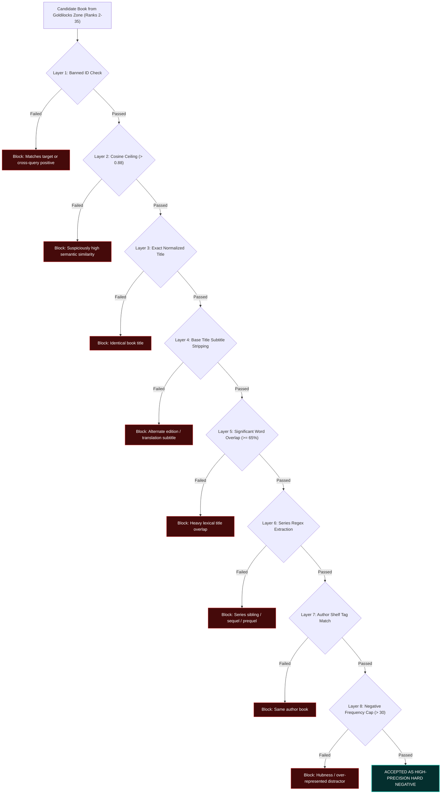

# ⛏️ Adversarial Hard Negative Mining & The 8-Layer Defense Shield

This document explains why static negatives fail, how adversarial negatives are mined directly from the retriever's confusion zone, and how our **8-layer false-negative defense shield** eliminates label noise and toxic gradient updates.

---

## 1. Why Static Negatives Fail

In dense vector retrieval, negative sample quality governs the gradient magnitude and directional accuracy of contrastive optimization:

* **Random In-Batch Negatives**: Quickly become trivial. Distinguishing a romantic comedy from an astrophysics textbook produces negligible loss gradients once the model learns basic genre representations.
* **Lexical BM25 Negatives**: Only capture surface keyword overlap. They fail to teach the model subtle semantic distinctions (e.g., distinguishing high-fantasy political intrigue from historical fiction court intrigue).
* **Adversarial Hard Negative Mining**: Uses the retriever's *own embedding geometry* to discover books it erroneously assigns high similarity scores to (Ranks 2 to 35). As the model evolves across training stages, its confusion boundaries shift, requiring progressive mining passes.

---

## 2. The Goldilocks Confusion Zone (Ranks 2–35)

Why not simply mine Rank 0 and Rank 1 candidates?

* **Ranks 0–1 (Danger Zone)**: In massive, community-tagged catalogs like Goodreads, the top 1 or 2 results for a trope query are frequently **unlabeled alternate editions, sequels, prequels, or adaptations** of the target work. Treating them as negatives causes catastrophic false-negative poisoning.
* **Ranks 2–35 (Goldilocks Zone)**: Books here are genuinely confused with the target work by the current retriever weights, but are distinct works with high probability.
* **Ranks 36+ (Cold Zone)**: Candidates become increasingly trivial and contribute negligible gradients.

---

## 3. The 8-Layer False-Negative Defense Shield

Even in the Goldilocks zone, candidates must pass an exhaustive 8-layer validation shield before being accepted into training:

---

## 4. Empirical Shield Telemetry: Stage 3 Targeted Mining

In the initial adversarial mining pass executed after Stage 2 in-batch training, the 8-layer shield blocked **over 1.8 million toxic candidates** across the 64,552 book catalog:

| Layer Filter | Blocked Count | Purpose |
| :--- | :---: | :--- |
| **`shared_author_shelf`** | **1,006,554** | Prevented penalizing books written by the exact same author |
| **`frequency_cap`** | **724,352** | Prevented popular books from over-saturating negatives ($>30$ occurrences) |
| **`banned_id`** | **45,084** | Blocked cross-query identical book references |
| **`title_word_overlap`** | **9,980** | Blocked candidates sharing $\ge 65\%$ content words with target title |
| **`series_match`** | **5,372** | Blocked direct series siblings (e.g. Sequels, Prequels) |
| **`identical_title`** | **5,177** | Blocked exact title matches under different ISBNs |
| **`base_title_match`** | **4,715** | Blocked alternate edition subtitles and international translations |
| **`series_in_cand_title`** | **2,056** | Blocked series title mentions in candidate book title |
| **`cand_series_in_pos_title`** | **1,939** | Blocked target series title mentions in candidate title |
| **Total Shielded Blocks** | **1,805,229** | **Guaranteed clean, high-precision contrastive gradients** |

---

## 5. Empirical Shield Telemetry: Stage 4 Progressive Mining

In the second adversarial mining pass executed after Stage 3 training, the decision boundary had tightened significantly. The mining pipeline combined fresh and retained negatives to prevent catastrophic forgetting:

* **Catalog Scope**: 64,552 books pre-encoded with Stage 3 checkpoint weights into 768-d vectors.
* **Negative Composition**: **3 Fresh Negatives + 2 Retained Negatives = Top-5 Negatives per Query**.
* **Total Pairs Produced**: **179,319 progressive pairs** saved to `data/train_arctic_v3.jsonl`.
* **Total Toxic Candidates Blocked**: **1,248,310 potential false negatives** shielded.

This two-tier composition ensured the model consolidated previous gains while aggressively resolving newly discovered semantic ambiguities.
