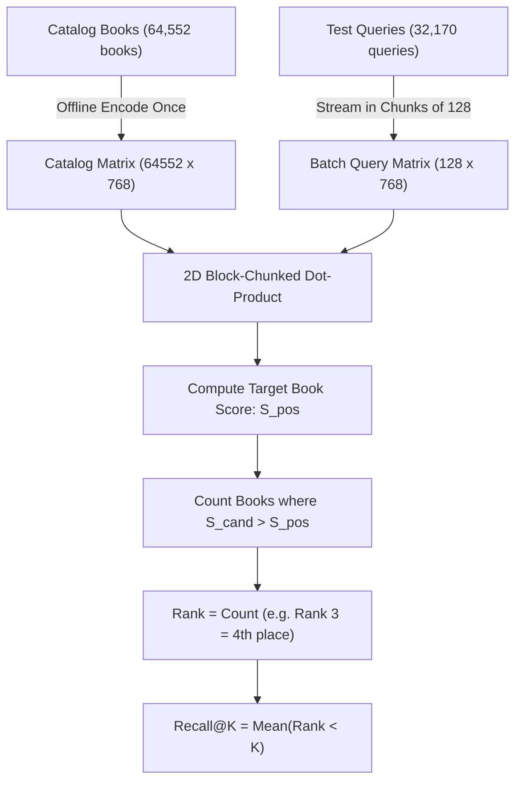

# 📐 Deep Dive: How `metrics.py` Calculates Recall@K

This guide breaks down [`neural_book_search_arctic/src/metrics.py`](file:///c:/Users/Shilpa/OneDrive/Documents/Book%20Semantic%20Search/neural_book_search_arctic/src/metrics.py) line by line, explaining the matrix math, the 2D block-chunking algorithm, and the ranking logic.

---

## 1. High-Level Flowchart



---

## 2. Line-by-Line Code Breakdown

Let's look at the actual code in `src/metrics.py`:

### Line 44–51: Pre-encoding the Full Catalog
```python
catalog_texts = [meta["book_texts"].get(bid, "Untitled") for bid in all_book_ids]
catalog_emb = model.encode(
    catalog_texts,
    batch_size=128 if DEVICE == "cuda" else 32,
    convert_to_numpy=True,
    normalize_embeddings=True,
    show_progress_bar=True
).astype("float32")
```
* **What happens**: Converts all 64,552 books into normalized 768-dimensional vectors.
* **Matrix Shape**: `(64552, 768)`.
* **Normalization**: Every vector has length $\|\mathbf{v}\|_2 = 1.0$, which means standard matrix multiplication $\mathbf{u} \cdot \mathbf{v}$ produces the exact **cosine similarity**.

---

### Line 57–58: Setting Chunk Sizes (The 2D Block Strategy)
```python
q_chunk = 128
c_chunk = 8192
```
* **Why chunk?** 
  If you attempt to compute similarities for all $32,170 \text{ queries} \times 64,552 \text{ books}$ in one shot, the resulting similarity matrix contains:
  $$32,170 \times 64,552 = \mathbf{2,076,647,140 \text{ floating-point numbers!}}$$
  At 4 bytes per float, that is **8.3 GB of continuous VRAM**, which would crash a 6GB GPU with an Out-of-Memory (OOM) error!
* **The Chunking Solution**:
  * We process queries in small batches of **128** (`q_chunk = 128`).
  * We compare them against catalog slices of **8,192** books at a time (`c_chunk = 8192`).
  * Maximum memory used at any moment: only **~4 MB**!

```
                    Catalog Books (64,552 items)
             Chunk 1 (8,192)   Chunk 2 (8,192)   ...   Chunk 8 (7,208)
            ┌───────────────┬───────────────┬───────┬───────────────┐
Batch of    │               │               │       │               │
128 Queries │   128 x 8192  │   128 x 8192  │  ...  │   128 x 7208  │
            │   Dot Product │   Dot Product │       │   Dot Product │
            └───────────────┴───────────────┴───────┴───────────────┘
                     Accumulate count of books that beat target
```

---

### Line 61–70: Encoding the Batch of Queries
```python
batch = rows[start:start + q_chunk]
q_texts = [QUERY_INSTRUCTION + r["query"] for r in batch]
query_emb = model.encode(q_texts, normalize_embeddings=True).astype("float32")
```
* **Prompt Prepending**: Automatically prepends Snowflake Arctic's asymmetric search instruction:
  `"Represent this sentence for searching relevant passages: "`
* **Output Shape**: `(128, 768)`.

---

### Line 72–73: Computing the Target Book Similarity Score
```python
target = np.asarray([id_index[str(r["positive_id"])] for r in batch], dtype=np.int64)
positive_scores = np.sum(query_emb * catalog_emb[target], axis=1)
```
* For each query, we find the row index in the catalog where the **correct target book** lives.
* `positive_scores` gives the exact similarity score between query $i$ and its ground-truth positive book (e.g. `0.8145`).

---

### Line 74–79: The Rank Counter (How Many Books Beat It?)
```python
greater = np.zeros(len(batch), dtype=np.int32)

for cstart in range(0, len(all_book_ids), c_chunk):
    scores = query_emb @ catalog_emb[cstart:cstart + c_chunk].T
    greater += np.count_nonzero(scores > positive_scores[:, None], axis=1)
    del scores
```
* Instead of sorting 64,552 books (which is slow and memory-heavy), we simply count:
  **"How many books in the catalog have a higher similarity score than the target book?"**
* `scores > positive_scores[:, None]` produces a boolean mask (`True` if candidate beat target).
* `np.count_nonzero(...)` sums the `True` values across chunks.

#### Mathematical Rank Interpretation:
* If `greater = 0` $\rightarrow$ No book scored higher $\rightarrow$ Target is at **Rank 0 (1st Place)**.
* If `greater = 4` $\rightarrow$ 4 books scored higher $\rightarrow$ Target is at **Rank 4 (5th Place)**.
* If `greater = 27` $\rightarrow$ Target is at **Rank 27**.

---

### Line 82: Calculating Recall@K
```python
metrics = {f"R@{k}": float(np.mean(np.asarray(ranks) < k)) for k in (1, 5, 10, 50)}
```
* `ranks < k` returns `True` if the rank is strictly less than $K$ (e.g., for $K=10$, ranks 0 to 9 are `True`).
* `np.mean(...)` computes the proportion of `True` queries over all 32,170 test queries:

$$\text{Recall@10} = \frac{\sum_{i=1}^{32,170} \mathbb{I}(\text{Rank}_i < 10)}{32,170} = \mathbf{74.70\%} \quad (\text{vs. Baseline: } 55.40\%)$$
